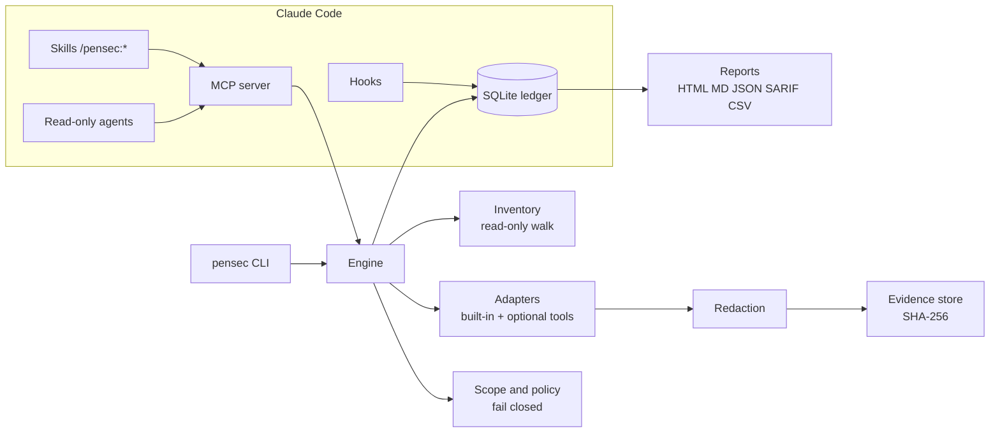

<p align="center">
  
</p>

<h1 align="center">PenSec</h1>

<p align="center">
  <b>Local, evidence-based application security assessment for your own code.</b><br>
  A standalone Go CLI and a Claude Code plugin. Passive by default. Honest about what it did not test.
</p>

<p align="center">
  <a href="https://github.com/ratomirjovanovic/pensec/actions/workflows/ci.yml"></a>
  <a href="https://scorecard.dev/viewer/?uri=github.com/ratomirjovanovic/pensec"></a>
  <a href="LICENSE"></a>
  
  
</p>

<p align="center">
  <a href="https://ratomirjovanovic.github.io/pensec/">Website and demo</a> ·
  <a href="https://github.com/ratomirjovanovic/pensec/wiki">Documentation</a> ·
  <a href="#quick-start">Quick start</a> ·
  <a href="#what-pensec-will-not-tell-you">Limitations</a>
</p>

---

Most scanners print a list of alerts and stop. PenSec keeps a **ledger**: every control it could check, how it checked it, the redacted evidence, and every control it could *not* decide. Findings are fingerprinted across runs, so a fix becomes `REMEDIATED` only when the check runs again and no longer sees the problem.

<p align="center">
  
  <br><sub>A real session on the bundled demo project, generated by <code>tools/termdemo</code>.</sub>
</p>

<p align="center">
  <a href="https://ratomirjovanovic.github.io/pensec/demo/">
    <picture>
      <source media="(prefers-color-scheme: dark)" srcset="docs/media/findings-dark.png">
      
    </picture>
  </a>
  <br><sub>Findings from a real scan of the bundled vulnerable fixture. <a href="https://ratomirjovanovic.github.io/pensec/demo/">Open the live demo</a> for the terminal replay and the full report.</sub>
</p>

## Why PenSec

| | |
|---|---|
| **Safe by default** | The default profile only reads the repository. It never runs install scripts, Makefiles or builds, never follows symlinks, and sends no traffic to any target. |
| **Human-authorized network tests** | Anything that sends a request needs a scope manifest that a person filled in and approved from an interactive terminal. An AI agent cannot approve it. |
| **No false "all clear"** | Only `PASS` and `FAIL` are decisive. A missing scanner is `BLOCKED`, a crash is `ERROR`, a heuristic hit is `SUSPECTED`. None of them count as secure. |
| **Evidence, not opinions** | Each finding links to a redacted, SHA-256 addressed evidence record. Model-proposed issues stay `HYPOTHESIS` until a human decides. |
| **Secrets never leak** | Values are masked before they are stored, printed, reported or returned to a model. `.env` and key files are recorded by name only. |
| **Remembers across sessions** | State lives in a local SQLite ledger, so context compaction or a restart does not lose results. |
| **Cross-domain thinking** | Links such as *identity -> authorization* (`BC1`) or *webhook -> payment state* (`FG1`) are created from shared assets in your code and tracked separately. |
| **Private** | No account, no telemetry, no cloud backend. |

## Quick start

### As a Claude Code plugin

```text
/plugin marketplace add ratomirjovanovic/pensec
/plugin install pensec@pensec            # macOS and Linux
/plugin install pensec-windows@pensec    # Windows
```

You can also run the same steps from a terminal with `claude plugin marketplace add ratomirjovanovic/pensec` and `claude plugin install pensec-windows@pensec` (`pensec@pensec` on macOS and Linux). Restart Claude Code afterwards; `/mcp` should list `plugin:pensec:pensec` as connected. To update later, run `/plugin marketplace update pensec`. If something goes wrong, see [Troubleshooting](https://github.com/ratomirjovanovic/pensec/wiki/Troubleshooting).

Then, in your project, ask Claude to check its security, or run:

```text
/pensec:start
```

That is the only command. Claude scans the project, has specialist reviewers look at what automation could not decide, triages the results, builds the fix plan and writes the reports, with a live checklist. At the end it asks one question - fix the plan, record the triage results, install missing scanners - and does what you choose, retesting after every fix. Later in the session it retests on its own whenever code changes. Commands that change a finding's status still show you a confirmation prompt, and network tests always need a scope you approve in your own terminal.

<details>
<summary>Individual skills</summary>

| Skill | What it does |
|---|---|
| `/pensec:init` | Create `.pensec/` and show what was detected |
| `/pensec:scan` | Passive scan with an honest summary |
| `/pensec:review` | Read-only specialist agents look at what automation could not decide |
| `/pensec:fix-plan` | Ordered fixes, applied one by one after your approval |
| `/pensec:retest` | Re-scan after changes and show the delta |
| `/pensec:report` | HTML, Markdown, JSON, SARIF, CSV |
| `/pensec:status` | Where the assessment stands and what is stale |

</details>

> The plugin installs prebuilt, checksum-verified binaries from the `plugin` and `plugin-windows` branches, which the release workflow publishes on every version tag ([how to verify them](docs/VERIFYING.md)). To use PenSec without Claude Code, see below.

### As a CLI

With a package manager:

```sh
brew tap ratomirjovanovic/pensec https://github.com/ratomirjovanovic/pensec && brew install ratomirjovanovic/pensec/pensec   # macOS, Linux
scoop bucket add pensec https://github.com/ratomirjovanovic/pensec; scoop install pensec/pensec     # Windows
```

Or download a binary from the [releases page](https://github.com/ratomirjovanovic/pensec/releases) (Linux and macOS on amd64 and arm64, Windows on amd64). For example on Linux:

```sh
v=v0.1.3
curl -fLO https://github.com/ratomirjovanovic/pensec/releases/download/$v/pensec-linux-amd64
curl -fLO https://github.com/ratomirjovanovic/pensec/releases/download/$v/SHA256SUMS
sha256sum --ignore-missing -c SHA256SUMS
chmod +x pensec-linux-amd64 && sudo mv pensec-linux-amd64 /usr/local/bin/pensec
```

On Windows (PowerShell), save `pensec-windows-amd64.exe` as `pensec.exe` in a folder on your `PATH`:

```powershell
Invoke-WebRequest https://github.com/ratomirjovanovic/pensec/releases/download/v0.1.3/pensec-windows-amd64.exe -OutFile pensec.exe
(Get-FileHash pensec.exe).Hash   # compare with the line in SHA256SUMS
```

Or install with Go 1.23 or later: `go install github.com/ratomirjovanovic/pensec/cmd/pensec@latest`. The binary has no runtime dependencies.

Then, in your project:

```sh
pensec assess          # init, scan with progress, reports and a summary
pensec findings        # then dig in
pensec fix-plan
```

Release binaries are reproducible and come with checksums, a CycloneDX SBOM and signed build provenance; [docs/VERIFYING.md](docs/VERIFYING.md) shows how to check them.

## How it works



1. **Inventory** walks the repository read-only and records files, routes, manifests, workflows, IaC, mobile manifests and AI/MCP usage.
2. **Plan** maps the control catalog (domains A to R) onto what was found. Controls without matching assets become `NOT_APPLICABLE` with a reason you can review.
3. **Adapters** run. Built-in checks are offline and always available; gitleaks, semgrep, osv-scanner and trivy are used only if you installed them. When semgrep is installed it runs PenSec's bundled offline rules (see [`rules/README.md`](rules/README.md)) plus any rules you configure. SARIF 2.1.0 files from analyzers you ran yourself (CodeQL or other SAST tools) are imported from `.pensec/sarif/*.sarif` and any paths listed in `scan.sarif_files`; PenSec never runs those tools. Imported results are hypotheses under control R-002, with snippets read and redacted from your files rather than taken from the SARIF.
4. **Findings** are redacted, fingerprinted and linked to evidence. Repeated runs update their lifecycle: `OPEN`, `REMEDIATED`, `REOPENED`, `FALSE_POSITIVE`, `RISK_ACCEPTED`.
5. **Edges** between domains are created only from shared assets and get their status from the linked controls.
6. **Reports** show confirmed findings, suspected signals, coverage by domain, every undecided control and the evidence index.

## What it checks

| Domain | Automated today (offline) | Needs review or runtime |
|---|---|---|
| A Inventory and architecture | entrypoints with file and line (`pensec routes`): HTTP routes for Express, NestJS, Next.js, Flask, FastAPI, Django, Go, Spring, Laravel, Rails, ASP.NET with router prefixes and mounts resolved; GraphQL schema operations; gRPC services; queue consumers and cron jobs; services in monorepos; OpenAPI drift | threat model |
| B Authentication | JWT `none` or unverified decode, cookie flags | login, reset and session lifecycle |
| C Authorization | | object and function level authorization (manual-assisted) |
| D Injection | eval, shell, SQL concatenation, unsafe deserialization | runtime probes |
| E Secrets and crypto | 16 high-specificity secret formats, tracked `.env` and key files, disabled TLS verification, weak hash or random | |
| F Business logic | | invariants, idempotency, races (manual-assisted) |
| G APIs and webhooks | webhook signature verification presence | contract vs runtime |
| H Web | raw HTML sinks, CORS wildcard with credentials | security headers (`production-observe`) |
| I Supply chain | missing lockfiles, npm install scripts, unpinned Python requirements | advisories via osv-scanner |
| J Infrastructure | Dockerfile root and unpinned base, privileged containers, public storage and admin ports in Terraform | trivy |
| K, L Mobile | Android manifest flags and exported components, iOS ATS | device runtime |
| N CI/CD | unpinned actions, script injection, `pull_request_target` checkout, token permissions | |
| O Observability | credentials in log calls | alerting review |
| P AI and MCP | model output reaching exec sinks, MCP server pinning and inline credentials | prompt-injection tests |
| R Assurance | evidence integrity, imported SARIF results | |

`pensec capabilities` prints the full catalog with each adapter's maturity. All adapters are currently `implemented_unvalidated`. The optional tool adapters are exercised in CI on every pull request against gitleaks 8.30.1, semgrep 1.182.0, osv-scanner 2.7.0 and trivy 0.76.1: the job scans the bundled vulnerable fixture and fails when an adapter does not complete or its parser misses the expected findings. Other versions may work but are not checked.

`pensec benchmark` runs every built-in rule against a versioned corpus of vulnerable and safe cases and prints TP, FP, FN, TN, precision and recall per rule. CI fails when a rule misses a vulnerable case or fires on a safe one, and each release attaches `benchmark.json`. A rule counts as `implemented_and_benchmarked` only with precision and recall of at least 0.95 on at least 3 vulnerable and 3 safe cases. Today every rule has one of each, so none qualifies yet. The corpus is PenSec's own, so the numbers describe these cases, not real-world accuracy. On the public OWASP Benchmark for Java the built-in rules score 0.00: they match single lines and do not follow data flow, so they find none of its test cases (and raise no false alarms). Use Semgrep or another data flow aware analyzer through PenSec for Java injection findings; [docs/BENCHMARKS.md](docs/BENCHMARKS.md) has the numbers and how to reproduce them.

## Commands

| Command | What it does |
|---|---|
| `pensec assess` | The whole local assessment in one step: init if needed, scan with progress bars, reports and a summary |
| `pensec init` | Create `.pensec/` with config and a private ledger |
| `pensec plan` | Applicable controls, gates, candidate edges, inventory gaps |
| `pensec scan [--fail-on high]` | Passive scan, including SARIF import from `.pensec/sarif/`; exit code 4 when the gate is reached |
| `pensec retest [--changed]` | Files changed since the last scan, re-scan, delta; `--changed` re-runs only the adapters whose controls the changes affect |
| `pensec status` | Coverage, open findings, stale files, blockers, next action |
| `pensec findings [show ID]` | List or inspect findings; `apply --file` records many decisions at once |
| `pensec graph [--format mermaid]` | Domains and cross-domain edges |
| `pensec routes` | Discovered entrypoints (HTTP, GraphQL, gRPC, workers, cron) with file and line |
| `pensec fix-plan` | Ordered remediation steps |
| `pensec report [--format ...]` | HTML, Markdown, JSON, SARIF 2.1.0, CSV |
| `pensec evidence show ID \| verify` | Read or verify redacted evidence |
| `pensec diff [FROM TO]` | New, reopened, remediated, stale and waived findings between two assessments (default: previous vs latest) |
| `pensec export --bundle out.zip` | Report and redacted evidence with a SHA-256 manifest for a reviewer; never raw tool output |
| `pensec verify-bundle out.zip` | Recompute every hash in a bundle; compare the printed manifest hash with the sender's |
| `pensec scope init \| validate \| approve \| revoke` | Authorization for network tests |
| `pensec test --profile production-observe` | Header and cookie review of approved origins |
| `pensec feedback false-positive ID \| false-negative \| summary` | Prepare a report about a wrong or missed finding; prints a prefilled issue link, sends nothing |
| `pensec doctor` | Optional scanners and their network needs |
| `pensec benchmark` | TP, FP, FN and TN per built-in rule on the bundled corpus |
| `pensec selftest` | Runs a hostile fixture repository through scan, reports, MCP and hooks and checks PenSec was not steered by it |
| `pensec mcp` | Local stdio MCP server used by the plugin |

Human decisions are explicit and recorded:

```sh
pensec findings false-positive PSEC-0007 --by "Jane" --note "constant input, not user controlled"
pensec findings accept-risk   PSEC-0003 --by "Jane" --note "internal tool" --expires 2027-03-01
pensec findings apply --file decisions.json --by "Jane"   # many at once, all or nothing
```

`decisions.json` is an array of `{"finding_id", "action", "note", "expires"}` with `action` one of `confirm`, `false-positive`, `accept-risk` (needs `expires`) or `reopen`. Every entry is checked before anything is written, so one bad entry rejects the batch. In Claude Code this is how the guided assessment records triage results: you see the whole list in one confirmation prompt instead of one prompt per finding.

## Network tests

Network tests are off until you turn them on yourself:

```sh
pensec scope init                       # writes .pensec/scope.yaml, unusable as shipped
# fill in owner, written permission reference, purpose, targets, limits, acknowledged: true
pensec scope approve --by "Jane"        # interactive terminal only, bound to the file's SHA-256
pensec test --profile production-observe
```

The engine sends at most `max_requests_total` GET requests to the listed origins at the configured rate, never follows redirects, and checks every resolved address at connection time. Loopback, private and link-local addresses are refused unless the manifest explicitly allows a local fixture, and cloud metadata addresses are always refused. Editing `scope.yaml` invalidates the approval. Approvals are also bound to a per-user key kept outside the project (`approval.key` in your user config directory), so a scope file or ledger that arrives with a repository never counts as approved.

## In CI

```yaml
permissions:
  contents: read
  security-events: write
steps:
  - uses: actions/checkout@<pinned-sha>
  - id: pensec
    uses: ratomirjovanovic/pensec@<pinned-sha>   # v0.1.3 or later
    with:
      fail-on: high          # empty to never fail on findings
      new-only: "true"       # on pull requests, gate only on findings the change introduces
  - if: always()
    uses: github/codeql-action/upload-sarif@<pinned-sha>
    with:
      sarif_file: ${{ steps.pensec.outputs.sarif-file }}
```

The action downloads a release binary, checks it against `SHA256SUMS`, scans, writes SARIF, HTML, Markdown and JSON reports to `pensec-report/`, and adds a short job summary with counts only (`summary: full` lists findings; job summaries of public repositories are public). With `new-only`, the base commit is scanned in a separate worktree and only findings whose fingerprints are new count. Inputs and outputs are documented in [`action.yml`](action.yml).

## Before each commit

With [pre-commit](https://pre-commit.com), add this to `.pre-commit-config.yaml` and run `pensec init` once in the project:

```yaml
repos:
  - repo: https://github.com/ratomirjovanovic/pensec
    rev: v0.1.3
    hooks:
      - id: pensec-system   # uses the pensec on your PATH; use id: pensec to build it with Go 1.23+
```

The hook runs `pensec scan --quiet --fail-on high` and blocks the commit when open high or critical findings exist. It scans the working tree, not only the staged files.

## What PenSec will not tell you

- That your application is secure. No tool can prove the absence of vulnerabilities.
- Anything about controls it reports as `BLOCKED`, `UNSUPPORTED`, `SUSPECTED`, `INCONCLUSIVE`, `ERROR` or `STALE`.
- Results from runtime profiles other than `production-observe`. `staging-active`, ZAP and emulator tests are on the roadmap and are reported as `UNSUPPORTED` today.

A PenSec report is an automated technical assessment. It is not a certification, an attestation, a legal opinion or an independently signed penetration test.

## Roadmap

| Milestone | Scope | State |
|---|---|---|
| M0 Foundation | CLI, ledger, scope policy, inventory, static report | done |
| M1 Public alpha | built-in adapters, optional tool adapters, bundled Semgrep rules, edges, HTML/JSON/SARIF, plugin, signed reproducible releases | done (v0.1.1) |
| M2 Context-safe beta | per-domain invalidation, targeted retest, evidence bundles, delta reports, hostile-repository suite | done |
| M3 Runtime beta | staging profile with role and tenant fixtures, ZAP adapter | planned |
| M4 Mobile and AI | MobSF and emulator adapters, prompt-injection suite | planned |
| 1.0 | frozen schemas ([done](docs/SCHEMAS.md)), benchmark corpus with at least 3 vulnerable and 3 safe cases per rule, external review | in progress |

See the [issues](https://github.com/ratomirjovanovic/pensec/issues) for details.

## Wrong or missed findings

Tell us, and the rule gets fixed. `pensec feedback false-positive <PSEC-ID>` or `pensec feedback false-negative --rule <id>` (or `/pensec:feedback` in Claude Code) prepares a report with rule metadata only and prints a prefilled issue link; nothing is sent unless you submit it. Reports are grouped by rule, prioritized automatically and every fix adds a benchmark case. See [docs/FEEDBACK.md](docs/FEEDBACK.md).

## Contributing and security

Contributions are welcome. Start with [CONTRIBUTING.md](CONTRIBUTING.md). Please report vulnerabilities in PenSec itself privately as described in [SECURITY.md](SECURITY.md).

## License

PenSec is free and open source software under the [GNU Affero General Public License v3.0](LICENSE) (AGPL-3.0-only).

You may use, study, modify and share it, including inside companies. If you distribute PenSec or a modified version, or let others use a modified version over a network (for example as a hosted scanning service), you must publish the complete corresponding source code under the same license. Commercial licensing for uses that cannot meet these terms is available from the copyright holder.

Third-party scanners that PenSec can call keep their own licenses. The license does not apply to the projects you assess or to the reports PenSec produces about them.
