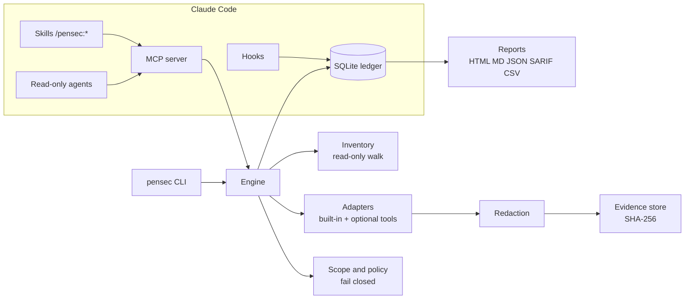

<p align="center">
  
</p>

<h1 align="center">PenSec</h1>

<p align="center">
  <b>Local, evidence-based application security assessment for your own code.</b><br>
  A standalone Go CLI and a Claude Code plugin. Passive by default. Honest about what it did not test.
</p>

<p align="center">
  <a href="https://github.com/ratomirjovanovic/pensec/actions/workflows/ci.yml"></a>
  <a href="LICENSE"></a>
  
  
</p>

<p align="center">
  <a href="https://ratomirjovanovic.github.io/pensec/">Website and demo</a> ·
  <a href="https://github.com/ratomirjovanovic/pensec/wiki">Documentation</a> ·
  <a href="#quick-start">Quick start</a> ·
  <a href="#what-pensec-will-not-tell-you">Limitations</a>
</p>

---

Most scanners print a list of alerts and stop. PenSec keeps a **ledger**: every control it could check, how it checked it, the redacted evidence, and every control it could *not* decide. Findings are fingerprinted across runs, so a fix becomes `REMEDIATED` only when the check runs again and no longer sees the problem.

```text
$ pensec scan
Assessment asmt_0001: COMPLETE
  builtin-secrets    OK       2 signals
  builtin-code       OK      14 signals
  builtin-cicd       OK       5 signals
  gitleaks           BLOCKED  gitleaks is not installed (optional)
Decisive coverage: 21/44 applicable controls (48%). Edges: 12 (0 verified, 6 failed, 6 open)
Findings: 31 open (31 new, 0 reopened, 0 remediated in this run)

BLOCKED/UNSUPPORTED/SUSPECTED controls are not secure; see `pensec status` and `pensec findings`.
```

<p align="center">
  <a href="https://ratomirjovanovic.github.io/pensec/demo/">
    <picture>
      <source media="(prefers-color-scheme: dark)" srcset="docs/media/findings-dark.png">
      
    </picture>
  </a>
  <br><sub>Findings from a real scan of the bundled vulnerable fixture. <a href="https://ratomirjovanovic.github.io/pensec/demo/">Open the live demo</a> for the terminal replay and the full report.</sub>
</p>

## Why PenSec

| | |
|---|---|
| **Safe by default** | The default profile only reads the repository. It never runs install scripts, Makefiles or builds, never follows symlinks, and sends no traffic to any target. |
| **Human-authorized network tests** | Anything that sends a request needs a scope manifest that a person filled in and approved from an interactive terminal. An AI agent cannot approve it. |
| **No false "all clear"** | Only `PASS` and `FAIL` are decisive. A missing scanner is `BLOCKED`, a crash is `ERROR`, a heuristic hit is `SUSPECTED`. None of them count as secure. |
| **Evidence, not opinions** | Each finding links to a redacted, SHA-256 addressed evidence record. Model-proposed issues stay `HYPOTHESIS` until a human decides. |
| **Secrets never leak** | Values are masked before they are stored, printed, reported or returned to a model. `.env` and key files are recorded by name only. |
| **Remembers across sessions** | State lives in a local SQLite ledger, so context compaction or a restart does not lose results. |
| **Cross-domain thinking** | Links such as *identity -> authorization* (`BC1`) or *webhook -> payment state* (`FG1`) are created from shared assets in your code and tracked separately. |
| **Private** | No account, no telemetry, no cloud backend. |

## Quick start

### As a Claude Code plugin

```text
/plugin marketplace add ratomirjovanovic/pensec
/plugin install pensec@pensec
```

Then, in your project:

```text
/pensec:init        # create .pensec/ and show what was detected
/pensec:scan        # passive scan with an honest summary
/pensec:review      # read-only specialist agents look at what automation could not decide
/pensec:fix-plan    # ordered fixes; nothing is changed without your approval
/pensec:report      # HTML, Markdown, JSON, SARIF, CSV
```

> Prebuilt binaries for the plugin are tracked in [#4](https://github.com/ratomirjovanovic/pensec/issues/4). Until then, build the binary into the plugin's `bin/` directory as shown below.

### As a CLI

```sh
git clone https://github.com/ratomirjovanovic/pensec
cd pensec
go build -o bin/pensec ./cmd/pensec        # bin/pensec.exe on Windows

cd /path/to/your/project
pensec init
pensec scan
pensec findings
pensec report --format html,sarif
```

Requires Go 1.23 or later to build. The binary has no runtime dependencies.

## How it works



1. **Inventory** walks the repository read-only and records files, routes, manifests, workflows, IaC, mobile manifests and AI/MCP usage.
2. **Plan** maps the control catalog (domains A to R) onto what was found. Controls without matching assets become `NOT_APPLICABLE` with a reason you can review.
3. **Adapters** run. Built-in checks are offline and always available; gitleaks, semgrep, osv-scanner and trivy are used only if you installed them.
4. **Findings** are redacted, fingerprinted and linked to evidence. Repeated runs update their lifecycle: `OPEN`, `REMEDIATED`, `REOPENED`, `FALSE_POSITIVE`, `RISK_ACCEPTED`.
5. **Edges** between domains are created only from shared assets and get their status from the linked controls.
6. **Reports** show confirmed findings, suspected signals, coverage by domain, every undecided control and the evidence index.

## What it checks

| Domain | Automated today (offline) | Needs review or runtime |
|---|---|---|
| A Inventory and architecture | entrypoints with file and line (`pensec routes`): HTTP routes for Express, NestJS, Next.js, Flask, FastAPI, Django, Go, Spring, Laravel, Rails, ASP.NET with router prefixes and mounts resolved; GraphQL schema operations; gRPC services; queue consumers and cron jobs; services in monorepos; OpenAPI drift | threat model |
| B Authentication | JWT `none` or unverified decode, cookie flags | login, reset and session lifecycle |
| C Authorization | | object and function level authorization (manual-assisted) |
| D Injection | eval, shell, SQL concatenation, unsafe deserialization | runtime probes |
| E Secrets and crypto | 16 high-specificity secret formats, tracked `.env` and key files, disabled TLS verification, weak hash or random | |
| F Business logic | | invariants, idempotency, races (manual-assisted) |
| G APIs and webhooks | webhook signature verification presence | contract vs runtime |
| H Web | raw HTML sinks, CORS wildcard with credentials | security headers (`production-observe`) |
| I Supply chain | missing lockfiles, npm install scripts, unpinned Python requirements | advisories via osv-scanner |
| J Infrastructure | Dockerfile root and unpinned base, privileged containers, public storage and admin ports in Terraform | trivy |
| K, L Mobile | Android manifest flags and exported components, iOS ATS | device runtime |
| N CI/CD | unpinned actions, script injection, `pull_request_target` checkout, token permissions | |
| O Observability | credentials in log calls | alerting review |
| P AI and MCP | model output reaching exec sinks, MCP server pinning and inline credentials | prompt-injection tests |
| R Assurance | evidence integrity | |

`pensec capabilities` prints the full catalog with each adapter's maturity. All adapters are currently `implemented_unvalidated`: they pass this repository's fixture suite, but no public benchmark has been published yet.

## Commands

| Command | What it does |
|---|---|
| `pensec init` | Create `.pensec/` with config and a private ledger |
| `pensec plan` | Applicable controls, gates, candidate edges, inventory gaps |
| `pensec scan [--fail-on high]` | Passive scan; exit code 4 when the gate is reached |
| `pensec retest` | Files changed since the last scan, re-scan, delta |
| `pensec status` | Coverage, open findings, stale files, blockers, next action |
| `pensec findings [show ID]` | List or inspect findings |
| `pensec graph [--format mermaid]` | Domains and cross-domain edges |
| `pensec fix-plan` | Ordered remediation steps |
| `pensec report [--format ...]` | HTML, Markdown, JSON, SARIF 2.1.0, CSV |
| `pensec evidence show ID \| verify` | Read or verify redacted evidence |
| `pensec scope init \| validate \| approve \| revoke` | Authorization for network tests |
| `pensec test --profile production-observe` | Header and cookie review of approved origins |
| `pensec doctor` | Optional scanners and their network needs |
| `pensec mcp` | Local stdio MCP server used by the plugin |

Human decisions are explicit and recorded:

```sh
pensec findings false-positive PSEC-0007 --by "Jane" --note "constant input, not user controlled"
pensec findings accept-risk   PSEC-0003 --by "Jane" --note "internal tool" --expires 2027-03-01
```

## Network tests

Network tests are off until you turn them on yourself:

```sh
pensec scope init                       # writes .pensec/scope.yaml, unusable as shipped
# fill in owner, written permission reference, purpose, targets, limits, acknowledged: true
pensec scope approve --by "Jane"        # interactive terminal only, bound to the file's SHA-256
pensec test --profile production-observe
```

The engine sends at most `max_requests_total` GET requests to the listed origins at the configured rate, never follows redirects, and checks every resolved address at connection time. Loopback, private and link-local addresses are refused unless the manifest explicitly allows a local fixture, and cloud metadata addresses are always refused. Editing `scope.yaml` invalidates the approval.

## In CI

```yaml
- run: go install github.com/ratomirjovanovic/pensec/cmd/pensec@latest
- run: pensec init && pensec scan --fail-on high
- run: pensec report --format sarif --out reports
- uses: github/codeql-action/upload-sarif@<pinned-sha>
  with:
    sarif_file: reports
```

## What PenSec will not tell you

- That your application is secure. No tool can prove the absence of vulnerabilities.
- Anything about controls it reports as `BLOCKED`, `UNSUPPORTED`, `SUSPECTED`, `INCONCLUSIVE`, `ERROR` or `STALE`.
- Results from runtime profiles other than `production-observe`. `staging-active`, ZAP and emulator tests are on the roadmap and are reported as `UNSUPPORTED` today.

A PenSec report is an automated technical assessment. It is not a certification, an attestation, a legal opinion or an independently signed penetration test.

## Roadmap

| Milestone | Scope | State |
|---|---|---|
| M0 Foundation | CLI, ledger, scope policy, inventory, static report | done |
| M1 Public alpha | built-in adapters, optional tool adapters, edges, HTML/JSON/SARIF, plugin | in progress |
| M2 Context-safe beta | per-domain invalidation, evidence bundles, delta reports, agent evals | planned |
| M3 Runtime beta | staging profile with role and tenant fixtures, ZAP adapter | planned |
| M4 Mobile and AI | MobSF and emulator adapters, prompt-injection suite | planned |
| 1.0 | stable schemas, benchmark corpus, signed releases, external review | planned |

See the [issues](https://github.com/ratomirjovanovic/pensec/issues) for details.

## Contributing and security

Contributions are welcome. Start with [CONTRIBUTING.md](CONTRIBUTING.md). Please report vulnerabilities in PenSec itself privately as described in [SECURITY.md](SECURITY.md).

## License

PenSec is free and open source software under the [GNU Affero General Public License v3.0](LICENSE) (AGPL-3.0-only).

You may use, study, modify and share it, including inside companies. If you distribute PenSec or a modified version, or let others use a modified version over a network (for example as a hosted scanning service), you must publish the complete corresponding source code under the same license. Commercial licensing for uses that cannot meet these terms is available from the copyright holder.

Third-party scanners that PenSec can call keep their own licenses. The license does not apply to the projects you assess or to the reports PenSec produces about them.
