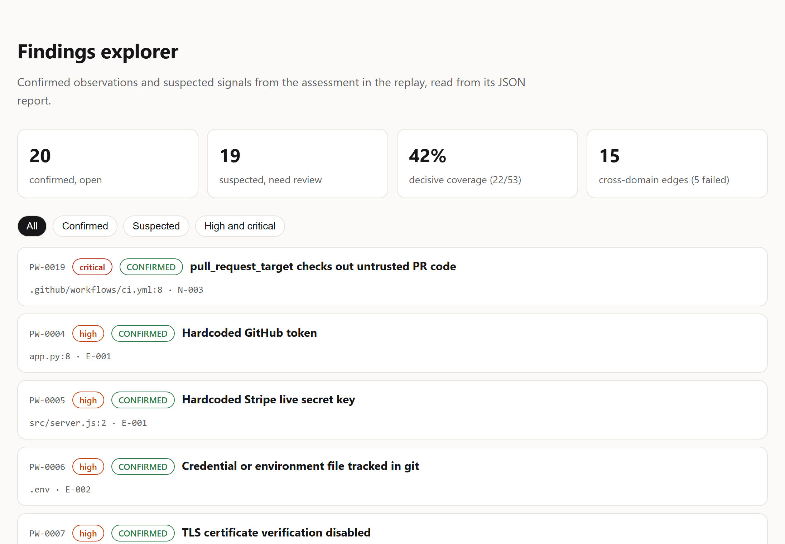
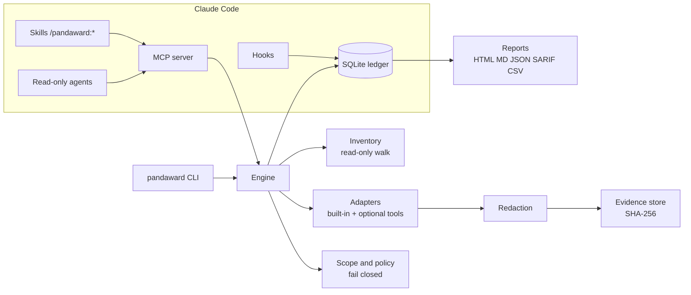

<p align="center">
  
</p>

<h1 align="center">PandaWard</h1>

<p align="center">
  <b>Local, evidence-based application security assessment for your own code.</b><br>
  A standalone Go CLI and a Claude Code plugin. Passive by default. Honest about what it did not test.
</p>

<p align="center">
  <a href="https://github.com/ratomirjovanovic/pandaward/actions/workflows/ci.yml"></a>
  <a href="https://scorecard.dev/viewer/?uri=github.com/ratomirjovanovic/pandaward"></a>
  <a href="LICENSE"></a>
  
  
</p>

<p align="center">
  <a href="https://pandaward.dev/">Website and demo</a> ·
  <a href="https://github.com/ratomirjovanovic/pandaward/wiki">Documentation</a> ·
  <a href="#quick-start">Quick start</a> ·
  <a href="#what-pandaward-will-not-tell-you">Limitations</a>
</p>

---

Most scanners print a list of alerts and stop. PandaWard keeps a **ledger**: every control it could check, how it checked it, the redacted evidence, and every control it could *not* decide. Findings are fingerprinted across runs, so a fix becomes `REMEDIATED` only when the check runs again and no longer sees the problem, and a moved or renamed file keeps its findings, their IDs and your triage instead of reading as fixed.

<p align="center">
  
  <br><sub>A real session on the bundled demo project, generated by <code>tools/termdemo</code>.</sub>
</p>

<p align="center">
  <a href="https://pandaward.dev/demo/">
    <picture>
      <source media="(prefers-color-scheme: dark)" srcset="docs/media/findings-dark.png">
      
    </picture>
  </a>
  <br><sub>Findings from a real scan of the bundled vulnerable fixture. <a href="https://pandaward.dev/demo/">Open the live demo</a> for the terminal replay and the full report.</sub>
</p>

## Why PandaWard

| | |
|---|---|
| **Safe by default** | The default profile only reads the repository. It never runs install scripts, Makefiles or builds, never follows symlinks, and sends no traffic to any target. |
| **Human-authorized network tests** | Anything that sends a request needs a scope manifest that a person filled in and approved from an interactive terminal. An AI agent cannot approve it. |
| **No false "all clear"** | Only `PASS` and `FAIL` are decisive. A missing scanner is `BLOCKED`, a crash is `ERROR`, a heuristic hit is `SUSPECTED`. None of them count as secure. |
| **Evidence, not opinions** | Each finding links to a redacted, SHA-256 addressed evidence record. Model-proposed issues stay `HYPOTHESIS` until a human decides. |
| **Secrets never leak** | Values are masked before they are stored, printed, reported or returned to a model. `.env` and key files are recorded by name only. |
| **Remembers across sessions** | State lives in a local SQLite ledger, so context compaction or a restart does not lose results. |
| **Cross-domain thinking** | Links such as *identity -> authorization* (`BC1`) or *webhook -> payment state* (`FG1`) are created from shared assets in your code and tracked separately. |
| **Private** | No account and no cloud backend. Usage telemetry is off unless you turn it on yourself, and `pandaward telemetry show` prints every byte it would send ([details](docs/TELEMETRY.md)). |

> **Formerly PenSec.** The project was renamed to PandaWard in 0.2.0. If you used PenSec, see [Moving from PenSec](#moving-from-pensec).

## Quick start

### As a Claude Code plugin

```text
/plugin marketplace add ratomirjovanovic/pandaward
/plugin install pandaward@pandaward            # macOS and Linux
/plugin install pandaward-windows@pandaward    # Windows
```

You can also run the same steps from a terminal with `claude plugin marketplace add ratomirjovanovic/pandaward` and `claude plugin install pandaward-windows@pandaward` (`pandaward@pandaward` on macOS and Linux). Restart Claude Code afterwards; `/mcp` should list `plugin:pandaward:pandaward` as connected. Install only one of the two plugins. If something goes wrong, see [Troubleshooting](https://github.com/ratomirjovanovic/pandaward/wiki/Troubleshooting).

**Updating.** Claude Code does not update third-party marketplaces on its own unless you turn it on. Either turn on auto-update once (`/plugin`, then Marketplaces, `pandaward`, Enable auto-update), or update by hand:

```sh
claude plugin marketplace update pandaward
claude plugin update pandaward-windows@pandaward   # or pandaward@pandaward on macOS and Linux
```

Then restart Claude Code. `/plugin` shows the installed version.

**Uninstalling.** `claude plugin uninstall pandaward-windows@pandaward` (or `pandaward@pandaward`), then `claude plugin marketplace remove pandaward`. Results stay in each project's `.pandaward/` directory until you delete it. The [uninstall guide](https://github.com/ratomirjovanovic/pandaward/wiki/Installation#uninstalling) covers the CLI packages and every file PandaWard creates.

Then, in your project, ask Claude to check its security, or run:

```text
/pandaward:start
```

That is the only command. Claude scans the project, has specialist reviewers look at what automation could not decide, triages the results, builds the fix plan and writes the reports, with a live checklist. At the end it asks one question - fix the plan, record the triage results, install missing scanners - and does what you choose, retesting after every fix. Later in the session it retests on its own whenever code changes. Commands that change a finding's status still show you a confirmation prompt, and network tests always need a scope you approve in your own terminal.

<details>
<summary>Individual skills</summary>

| Skill | What it does |
|---|---|
| `/pandaward:init` | Create `.pandaward/` and show what was detected |
| `/pandaward:scan` | Passive scan with an honest summary |
| `/pandaward:review` | Read-only specialist agents look at what automation could not decide |
| `/pandaward:fix-plan` | Ordered fixes, applied one by one after your approval |
| `/pandaward:retest` | Re-scan after changes and show the delta |
| `/pandaward:report` | HTML, Markdown, JSON, SARIF, CSV |
| `/pandaward:status` | Where the assessment stands and what is stale |

</details>

> The plugin installs prebuilt, checksum-verified binaries from the `plugin` and `plugin-windows` branches, which the release workflow publishes on every version tag ([how to verify them](docs/VERIFYING.md)). To use PandaWard without Claude Code, see below.

### As a CLI

With a package manager:

```sh
brew tap ratomirjovanovic/pandaward https://github.com/ratomirjovanovic/pandaward && brew install ratomirjovanovic/pandaward/pandaward   # macOS, Linux
scoop bucket add pandaward https://github.com/ratomirjovanovic/pandaward; scoop install pandaward/pandaward     # Windows
```

Or download a binary from the [releases page](https://github.com/ratomirjovanovic/pandaward/releases) (Linux and macOS on amd64 and arm64, Windows on amd64). For example on Linux:

```sh
v=v0.2.13
curl -fLO https://github.com/ratomirjovanovic/pandaward/releases/download/$v/pandaward-linux-amd64
curl -fLO https://github.com/ratomirjovanovic/pandaward/releases/download/$v/SHA256SUMS
sha256sum --ignore-missing -c SHA256SUMS
chmod +x pandaward-linux-amd64 && sudo mv pandaward-linux-amd64 /usr/local/bin/pandaward
```

On Windows (PowerShell), save `pandaward-windows-amd64.exe` as `pandaward.exe` in a folder on your `PATH`:

```powershell
Invoke-WebRequest https://github.com/ratomirjovanovic/pandaward/releases/download/v0.2.13/pandaward-windows-amd64.exe -OutFile pandaward.exe
(Get-FileHash pandaward.exe).Hash   # compare with the line in SHA256SUMS
```

Or install with Go 1.26 or later: `go install github.com/ratomirjovanovic/pandaward/cmd/pandaward@latest`. The binary has no runtime dependencies.

Update with `brew upgrade pandaward` or `scoop update pandaward`; for a downloaded binary, replace the file with the new release. Remove with `brew uninstall pandaward` or `scoop uninstall pandaward`, or delete the binary. `pandaward version` shows what you have.

Then, in your project:

```sh
pandaward assess          # init, scan with progress, reports and a summary
pandaward findings        # then dig in
pandaward fix-plan
```

Release binaries are reproducible and come with checksums, a CycloneDX SBOM and signed build provenance; [docs/VERIFYING.md](docs/VERIFYING.md) shows how to check them.

## How it works



1. **Inventory** walks the repository read-only and records files, routes, manifests, workflows, IaC, mobile manifests and AI/MCP usage.
2. **Plan** maps the control catalog (domains A to R) onto what was found. Controls without matching assets become `NOT_APPLICABLE` with a reason you can review.
3. **Adapters** run. Built-in checks are offline and always available; gitleaks, semgrep, osv-scanner, trivy and apktool are used only if you installed them. osv-scanner and trivy also need `scan.allow_tool_network: true`, which is off by default: osv-scanner then sends the package names and versions from your lockfiles to api.osv.dev, and trivy only downloads its vulnerability database. Until it is set they are BLOCKED with a reason that says this, and `/pandaward:start` offers the switch once. When an override in the workspace root (`pnpm.overrides`, `overrides` or `resolutions` in package.json, or `overrides` in pnpm-workspace.yaml) replaces a package with a local one (`link:`, `file:`, `workspace:` or `portal:`), an osv-scanner result for that package is dropped if the lockfile entry is that local package, since the registry package's advisories do not apply to code that is not installed; the adapter line counts them and names the overrides. A result is kept, and named in the adapter line, when the lockfile still pins a registry version or the override is an `npm:` alias. A gitleaks match whose value is shaped like a placeholder (a run of 8 or more sequential or repeated characters, a word such as dummy, example or changeme, a value starting with `test_`, a JWT with a short signature or dummy claims, or the fallback after `secrets.NAME ||` in a workflow) is kept but listed as info for review instead of counting against E-005; the value is judged in memory and never stored, a `service_role` JWT is never treated as a placeholder, and the adapter line says how many were listed. apktool decodes `.apk` files found in the project (resources only, never the app's code) so the manifest checks also run on what you ship (K-005). If you run [MobSF](https://github.com/MobSF/Mobile-Security-Framework-MobSF) yourself on this machine, set `scan.mobsf_url` (for example `http://127.0.0.1:8000`) and export its REST API key as `MOBSF_API_KEY`; PandaWard uploads the `.apk` and `.ipa` files it finds to that server, runs the static scan and reports MobSF's high and warning items as hypotheses under K-006 (APK) and L-005 (IPA). Code findings that MobSF reports only in bundled library code, outside the app's own package namespace, are listed for review instead. Only loopback addresses are accepted, proxies and redirects are ignored, and the key never appears in evidence, logs or reports. The adapter is tested against MobSF 4.5.3. When semgrep is installed it runs PandaWard's bundled offline rules (see [`rules/README.md`](rules/README.md)) plus any rules you configure. SARIF 2.1.0 files from analyzers you ran yourself (CodeQL or other SAST tools) are imported from `.pandaward/sarif/*.sarif` and any paths listed in `scan.sarif_files`; PandaWard never runs those tools. Imported results are hypotheses under control R-002, with snippets read and redacted from your files rather than taken from the SARIF. The directories in `inventory.exclude` (build output such as `.next/` and `dist/`, `node_modules/` and the like) apply to every adapter: results a scanner reports there are dropped, and the adapter line in the summary says how many.
4. **Findings** are redacted, fingerprinted and linked to evidence. Repeated runs update their lifecycle: `OPEN`, `REMEDIATED`, `REOPENED`, `FALSE_POSITIVE`, `RISK_ACCEPTED`. Identical hits in one file are told apart by position, so fixing one of them remediates that one; a finding whose file was moved or renamed keeps its ID and status and is reported as moved, never as fixed.
5. **Edges** between domains are created only from shared assets and get their status from the linked controls.
6. **Reports** show confirmed findings, suspected signals, coverage by domain, every undecided control and the evidence index. Decisive coverage (PASS or FAIL over applicable controls) is split by how each control was decided: automatic (static and external adapters in the passive scan), runtime (an approved runtime profile: production-observe, staging-active or local-runtime) and attested (a manual control a person accepted after review, see [Attested manual controls](#attested-manual-controls)). Not applicable controls are counted separately and stay outside the denominator. Every undecided control gets one next step, built from its method, status and stored reason, such as "install osv-scanner (see `pandaward doctor`), then run `pandaward retest`", and a **Path to 100%** section groups the undecided controls by that step. Some steps say a control cannot be decided in this release (runtime checks without an adapter); those keep coverage below 100% on purpose. Manual controls are on the path through attestation.

In Claude Code, hooks keep the ledger current without any command. Edited files are marked stale as they change, and when Claude finishes a turn that edited files, PandaWard runs a changed-only passive retest (bounded at 40 seconds) and hands any new or reopened findings back to Claude, which explains them and offers a fix. A clean retest stays silent; one that runs out of time or fails says so instead of claiming anything is fixed. Set `hooks.auto_retest: false` in `.pandaward/config.yaml` to turn it off.

While the specialist reviewers run, you can see what each one is doing. Their rows in the subagent panel below the prompt show the elapsed time, files read, searches, recorded hypotheses and the file or pattern they are on, refreshed by Claude Code. In the chat, Claude passes on a line when a reviewer starts, records a hypothesis or finishes, gives a short summary about once a minute in between, and warns when a reviewer has gone quiet for 10 minutes. The chat lines need Claude Code's Monitor tool, which on Windows needs Git Bash. Hooks record this to `.pandaward/private/progress.jsonl` for subagents named `pandaward:*` only. They record file names and search patterns, never file contents, and `pandaward progress` shows the same view in a terminal.

### Attested manual controls

Five controls cannot be decided by automation: A-004 (threat model), C-003 (authorization of every route), F-001 (business invariants), O-001 (security event alerting) and Q-001 (rate limiting). They are BLOCKED until a person attests them:

1. A reviewer, usually a `/pandaward:review` agent, proposes PASS or FAIL with `pandaward_propose_attestation`, citing file and line evidence and optionally a test or command that shows it. PandaWard checks every cited file is inside the project and every line exists, reads and hashes the files itself and redacts the text. The proposal is pending and decides nothing. A proposal can also come from a file: `pandaward attest C-003 --propose --file proposal.json`.
2. You decide: `pandaward attest C-003 --show` lists the evidence, then `pandaward attest C-003 --accept --by "Jane" --note "walked every route"` or `--reject`. When an agent runs this for you, the PandaWard hook shows the proposal and asks you to confirm; no MCP tool can accept. An accept is refused when a cited file changed since the proposal.
3. From the next scan the control is PASS or FAIL with `decided_by: attested`, and reports list the reviewer, the date and every citation. A FAIL attestation creates no finding by itself; the concrete gaps are the hypotheses the reviewer recorded, which you confirm with `pandaward findings apply`.
4. The attestation becomes STALE, with the reason, when a cited file changes (the file is named), when the control catalog version changes, or after `attest.max_age_days` (180 by default; it can be lowered, never raised beyond 365). It stays STALE until a fresh proposal is accepted.

## What it checks

| Domain | Automated today (offline) | Needs review or runtime |
|---|---|---|
| A Inventory and architecture | entrypoints with file and line (`pandaward routes`): HTTP routes for Express, NestJS, Next.js, Flask, FastAPI, Django, Go, Spring, Laravel, Rails, ASP.NET with router prefixes and mounts resolved; GraphQL schema operations; gRPC services; queue consumers and cron jobs; services in monorepos; OpenAPI drift. For Next.js apps the file-system route table (pages, layouts, route handlers, metadata routes, server actions and middleware of every app, with route groups, dynamic and catch-all segments, parallel slots and intercepting folders resolved) decides A-002: PASS only when nothing found can add routes outside it, otherwise INCONCLUSIVE with each blocker named (a custom server, next.config or vercel.json rewrites and redirects to other origins or not resolvable statically, middleware that proxies or answers requests itself, another web framework or server, serverless function directories, PHP, an OpenAPI mismatch, skipped code files) | threat model |
| B Authentication | JWT `none` or unverified decode, cookie flags | revoked credentials refused (`staging-active`); login, reset and MFA flows |
| C Authorization | Supabase/Postgres RLS update policies that let users change privileged columns of their own row (from SQL migrations) | object and function level authorization with test identities (`staging-active`), route review (manual-assisted) |
| D Injection | eval, shell, SQL concatenation, unsafe deserialization | ZAP active scan (`staging-active`, opt-in) |
| E Secrets and crypto | 16 high-specificity secret formats, tracked `.env` and key files, tracked tool-local settings such as `.claude/settings.local.json`, disabled TLS verification, weak hash or random | |
| F Business logic | | invariants, idempotency, races (manual-assisted) |
| G APIs and webhooks | webhook signature verification presence | contract vs runtime |
| H Web | raw HTML sinks, CORS wildcard with credentials, CSP allowing `'unsafe-inline'` or `'unsafe-eval'` scripts in `vercel.json`, `netlify.toml`, `_headers` and literal Next.js `headers()` values | security headers and weak CSP (`production-observe`) |
| I Supply chain | missing lockfiles, npm install scripts, unpinned Python requirements | advisories via osv-scanner |
| J Infrastructure | Dockerfile root and unpinned base, privileged containers, public storage and admin ports in Terraform | trivy |
| K, L Mobile | Android manifest flags and exported components, credentials in SharedPreferences, world-readable storage; iOS ATS, `get-task-allow` in release entitlements, Keychain accessibility and credentials in UserDefaults | built APKs via apktool; built APKs and IPAs via a local MobSF server; plain credentials in app storage on an emulator or simulator (`local-runtime`) |
| N CI/CD | unpinned actions, container images without a digest, floating global tool installs in privileged jobs, script injection, `pull_request_target` checkout, token permissions | |
| O Observability | credentials in log calls | alerting review |
| P AI and MCP | model output reaching exec sinks, MCP server pinning and inline credentials, invisible Unicode (tags, bidi controls, zero-width characters) in agent instruction files (`AGENTS.md`, `CLAUDE.md`, `.cursorrules`, skills, `.claude/agents` and commands, MCP configs) and MCP tool descriptions, and injected instructions in MCP tool descriptions (TypeScript SDK, FastMCP, mcp-go, MCP JSON) | prompt-injection tests |
| R Assurance | evidence integrity, imported SARIF results | |

`pandaward capabilities` prints the full catalog with each adapter's maturity. All adapters are currently `implemented_unvalidated`. The optional tool adapters are exercised in CI on every pull request against gitleaks 8.30.1, semgrep 1.182.0, osv-scanner 2.7.0 and trivy 0.76.1: the job scans the bundled vulnerable fixture and fails when an adapter does not complete or its parser misses the expected findings. Other versions may work but are not checked.

`pandaward benchmark` runs every built-in rule against a versioned corpus of vulnerable and safe cases and prints TP, FP, FN, TN, precision and recall per rule. CI fails when a rule misses a vulnerable case or fires on a safe one, and each release attaches `benchmark.json`. A rule counts as `implemented_and_benchmarked` only with precision and recall of at least 0.95 on at least 3 vulnerable and 3 safe cases. Today every rule has one of each, so none qualifies yet. The corpus is PandaWard's own, so the numbers describe these cases, not real-world accuracy. On the public OWASP Benchmark for Java the built-in rules score 0.00: they match single lines and do not follow data flow, so they find none of its test cases (and raise no false alarms). Use Semgrep or another data flow aware analyzer through PandaWard for Java injection findings; [docs/BENCHMARKS.md](docs/BENCHMARKS.md) has the numbers and how to reproduce them.

## Commands

| Command | What it does |
|---|---|
| `pandaward assess` | The whole local assessment in one step: init if needed, scan with progress bars, reports and a summary |
| `pandaward init` | Create `.pandaward/` with config and a private ledger |
| `pandaward plan` | Applicable controls, gates, candidate edges, inventory gaps |
| `pandaward scan [--fail-on high]` | Passive scan, including SARIF import from `.pandaward/sarif/`; exit code 4 when the gate is reached. Progress lines on stderr show the step, a percentage and the time left (see below) |
| `pandaward retest [--changed]` | Files changed since the last scan, re-scan, delta; `--changed` re-runs only the adapters whose controls the changes affect |
| `pandaward status` | Coverage and how it was decided (automatic, runtime, attested, not applicable), open findings, stale files, blockers, next action, and the path to 100%: the undecided controls grouped by the step that would decide them |
| `pandaward findings [show ID]` | List or inspect findings; `apply --file` records many decisions at once |
| `pandaward attest --list \| <control> --show` | Attestations of manual controls: pending proposals and accepted verdicts with their evidence |
| `pandaward attest <control> --accept\|--reject --by NAME [--note text]` | A person decides a reviewer's proposal; the hook asks for confirmation when an agent runs it |
| `pandaward graph [--format mermaid]` | Domains and cross-domain edges |
| `pandaward routes` | Discovered entrypoints (HTTP, Next.js pages, layouts and middleware, GraphQL, gRPC, workers, cron) with file and line |
| `pandaward fix-plan` | Ordered remediation steps |
| `pandaward report [--format ...]` | HTML, Markdown, JSON, SARIF 2.1.0, CSV |
| `pandaward evidence show ID \| verify` | Read or verify redacted evidence |
| `pandaward diff [FROM TO]` | New, reopened, remediated, moved, stale and waived findings between two assessments (default: previous vs latest) |
| `pandaward progress [--watch] [--json]` | What the reviewer subagents of a guided review are doing; `--watch` prints a line per start, hypothesis and finish until all are done |
| `pandaward export --bundle out.zip` | Report and redacted evidence with a SHA-256 manifest for a reviewer; never raw tool output |
| `pandaward verify-bundle out.zip` | Recompute every hash in a bundle; compare the printed manifest hash with the sender's |
| `pandaward scope init [--print] [--target URL] \| validate \| approve \| revoke` | Authorization for network tests |
| `pandaward test --profile production-observe` | Header and cookie review of approved origins |
| `pandaward test --profile local-runtime` | Storage of the configured Android test build on a running emulator and the iOS test build in a booted simulator; real devices are refused |
| `pandaward test --profile staging-active` | Authorization checks with test identities, then a ZAP spider and passive scan of approved staging origins, active scan when the manifest allows it |
| `pandaward test --help` | Every profile with what it covers, the controls it decides, what it needs and whether it may target your own machine |
| `pandaward feedback false-positive ID \| false-negative \| summary` | Prepare a report about a wrong or missed finding; prints a prefilled issue link, sends nothing |
| `pandaward feedback pending \| submit \| mode ask\|batch\|off` | Reports not sent yet, grouped by rule, including missed issues found from confirmed reviewer findings; `submit` asks, then files them with `gh` or prints links |
| `pandaward doctor` | Optional scanners and their network needs |
| `pandaward benchmark` | TP, FP, FN and TN per built-in rule on the bundled corpus |
| `pandaward selftest` | Runs a hostile fixture repository (instructions in comments, README, OpenAPI, MCP descriptions and scanner output) through scan, reports, MCP and hooks and checks PandaWard was not steered by it; CI and every release run it and fail on any case |
| `pandaward mcp` | Local stdio MCP server used by the plugin |
| `pandaward telemetry [on \| off \| show]` | Opt-in usage counters, off by default; `on` needs an interactive terminal ([what is sent](docs/TELEMETRY.md)) |

Scans show how far they got. The first line is the plan: files, adapters and the expected time. Every line after it has the step, a percentage and the time left, such as `[7/8  27%] semgrep: running; about 4 min left`, and an adapter that runs long reports every 20 seconds. The percentage is weighted by how long each adapter is expected to take: on the first scan of a project it is estimated from the size of the code each adapter reads, and later scans use the durations recorded in the ledger. `--quiet` and `--json` turn the lines off; the MCP scan and retest tools send them as progress notifications.

Human decisions are explicit and recorded:

```sh
pandaward findings false-positive PW-0007 --by "Jane" --note "constant input, not user controlled"
pandaward findings accept-risk   PW-0003 --by "Jane" --note "internal tool" --expires 2027-03-01
pandaward findings remediated    PW-0012 --by "Jane" --note "fixed in #42"
pandaward findings apply --file decisions.json --by "Jane"   # many at once, all or nothing
```

`remediated` is for a fix that no scanner can confirm, mostly findings from the specialist reviewers: a finding a rule reported becomes `REMEDIATED` by itself when the rule runs again and no longer sees it. If the rule still sees it, or a reviewer records the same issue again, the finding becomes `REOPENED`.

`false-positive` dismisses a signal for the control it belongs to, but only through the next scan: triage never changes a control status. On the next full scan (`pandaward retest` or `pandaward scan`), a signal whose finding a person marked `FALSE_POSITIVE` and whose fingerprint is unchanged (same rule, same file, same code on the flagged line) no longer counts, and the control is decided from the signals that remain. If none remain, the control is `PASS` with a reason such as `check completed; 3 signal(s) dismissed as false positive by Jane; PASS applies to this check only`, which the reports show in the control ledger. The finding itself stays listed as `FALSE_POSITIVE`. If the flagged code changes, the signal has a new fingerprint and counts again. `RISK_ACCEPTED` findings still count, because accepted risk is real. Signals that carry no code snippet (file-level checks such as a missing lockfile or a workflow without a permissions block, and dependency advisories) keep their fingerprint when the code changes, so they are never dismissed this way and still count. After a triage that leaves a control with only dismissed signals, the CLI names that control and the command that re-decides it. `pandaward retest --changed` keeps the decisions of adapters whose inputs did not change, so run a full `pandaward retest` to apply a dismissal.

`decisions.json` is an array of `{"finding_id", "action", "note", "expires"}` with `action` one of `confirm`, `false-positive`, `accept-risk` (needs `expires`), `remediated` or `reopen`. Every entry is checked before anything is written, so one bad entry rejects the batch. In Claude Code this is how the guided assessment records triage results: you see the whole list in one confirmation prompt instead of one prompt per finding.

## Network tests

Network tests are off until you turn them on yourself:

```sh
pandaward scope init                       # drafts .pandaward/scope.yaml from the project, not approved
# review it; fill in owner, written permission reference, purpose, acknowledged: true
pandaward scope approve --by "Jane"        # interactive terminal only, bound to the file's SHA-256
pandaward test --profile production-observe
pandaward test --profile staging-active    # staging or local targets, needs ZAP
```

`pandaward test --help` prints what each profile covers, the controls it decides, what it needs and whether it may run against your own machine. The names are kept as they are because scope manifests and scripts use them; note that the permission checks live in `staging-active`, which also accepts a local target, while `local-runtime` is for mobile apps only:

| Profile | Covers | Decides | Needs | Local target |
|---|---|---|---|---|
| `production-observe` | Passive look at a deployed site: one GET per approved origin, then the security response headers, a weak CSP and cookie flags. No payloads, no login, redirects are not followed. | H-003 (needs approved origins that answer without errors) | scope.yaml approved with `pandaward scope approve` (GET in allowed_methods). No identities, no ZAP. Works for any environment, production included. | only when the manifest sets allow_private_addresses: true |
| `staging-active` | Permission checks with test identities (who may read which object or privileged route, and whether a revoked credential is still accepted), login, reset and MFA flows with negative cases, repeated and concurrent actions that must take effect once, prompt-injection payloads against an LLM endpoint, the OpenAPI contract checked without credentials when the manifest asks for it, then a ZAP spider and passive scan, and the ZAP active scan when the manifest allows it. | B-003 (needs flow_checks with a step that expects denied)<br>B-004 (needs an identity marked revoked: true)<br>C-001 (needs an authorization check of kind object)<br>C-002 (needs an authorization check of kind function)<br>D-005 (needs ZAP installed and zap.active_scan: true)<br>F-002 (needs effect_checks with control F-002)<br>G-002 (needs an OpenAPI document and contract.check: true)<br>M-001 (needs ZAP installed)<br>P-003 (needs llm_checks with a body template that holds {{payload}})<br>Q-002 (needs effect_checks with control Q-002) | scope.yaml approved with `pandaward scope approve`; identities and authorization_checks in it, with each credential in the environment variable its value_env names or returned by the identity_provisioning command; ZAP installed (Java 17+) for M-001 and D-005. State-changing methods only for flow, effect and LLM checks, with environment staging or local. Refused for environment: production. | yes, with environment: staging or local; loopback and private addresses need allow_private_addresses: true. Use this profile for permission checks against an app running on your machine |
| `local-runtime` | Mobile apps only: what the Android or iOS test build stored on an emulator or simulator (credentials in shared preferences or the preferences plist; key names are recorded, never values). Sends no network traffic. | K-003 (needs runtime.android_package and a running Android emulator)<br>L-002 (needs runtime.ios_bundle_id and a booted iOS simulator on macOS) | runtime.android_package in .pandaward/config.yaml, adb and a running emulator with the debuggable test build; or runtime.ios_bundle_id, xcrun and a booted simulator on macOS. No scope manifest. Real devices are refused. | not a web target: it reads an emulator or simulator on this machine. For a web app on localhost use staging-active |
| `manual-assisted` | Not a runtime profile in this release; `pandaward test` refuses it. Manual review runs through /pandaward:review. | nothing | nothing to run | not applicable |

`pandaward scope init` reads the project and drafts the manifest. It never overwrites an existing `scope.yaml`, and `--print` writes the draft to stdout instead. The draft has:

- **targets**: local dev URLs from package scripts (`next dev -p 3001`, `vite`, `astro dev` and others, with their default ports) and loopback URLs in `.env.example` files. A non-local URL only gets in when you pass `--target`, so a draft never points at production. With only local targets the draft sets `environment: local` and `allow_private_addresses: true`.
- **identities**: commented, one per role found in code (role enums and union types, zod enums, Postgres and Prisma enums, role checks such as `role === 'admin'`), plus one in another tenant and one revoked. Tables with RLS policies are noted.
- **authorization_checks**: commented, one per readable route from the route inventory, with dynamic segments as `<placeholders>` and dynamic routes first.

The authorization block stays empty and `acknowledged: false`, so the draft cannot run until a person reviews it and approves it.

The engine sends at most `max_requests_total` GET requests to the listed origins at the configured rate, never follows redirects, and checks every resolved address at connection time. Loopback, private and link-local addresses are refused unless the manifest explicitly allows a local fixture, and cloud metadata addresses are always refused. `pandaward scope approve` shows the exact line to type, `APPROVE` followed by the first 8 characters of the manifest's SHA-256 (for example `APPROVE ab26dcf2`), so the approval is tied to that file; anything else cancels and the error says what was expected and what was typed. Editing `scope.yaml` invalidates the approval. Approvals are also bound to a per-user key kept outside the project (`approval.key` in your user config directory), so a scope file or ledger that arrives with a repository never counts as approved.

`staging-active` runs your installed [ZAP](https://www.zaproxy.org/) (it needs Java 17+; PandaWard never installs it, and when it is missing the BLOCKED reason gives the install command for your OS: `winget install --id ZAP.ZAP -e`, `brew install --cask zap` or `sudo snap install zaproxy --classic`) through its automation framework: a spider and the passive scan decide M-001, and with `zap.active_scan: true` in the manifest the active scan also decides D-005 (injection). ZAP is chained to a PandaWard proxy on loopback that terminates TLS and sends each request through the same scope guard, so origins, excluded paths, allowed methods, the request budget, the rate limit and the address checks apply to every ZAP request. The guard also stops after three consecutive 429 or 5xx answers. A ZAP run that fails is `ERROR`, a run cut short by the budget or the guard is `INCONCLUSIVE`, and targets marked `environment: production` are refused. Set `runtime.zap_path` in `.pandaward/config.yaml` when ZAP is not on `PATH` or in its default install location.

`staging-active` also runs the manifest's `authorization_checks` before ZAP. You list test identities (name, tenant, the header that carries the credential and the environment variable that holds it; the credential itself never goes in the file) and read-only requests to objects or functions that exist for the test, each with the identities allowed to reach it:

```yaml
identities:
  - {name: alice, tenant: acme, header: Authorization, value_env: PANDAWARD_ID_ALICE}
  - {name: bob,   tenant: beta, header: Authorization, value_env: PANDAWARD_ID_BOB}
  - {name: carol, tenant: acme, header: Authorization, value_env: PANDAWARD_ID_CAROL}   # an admin
  - {name: alice-logged-out, tenant: acme, header: Authorization, value_env: PANDAWARD_ID_OLD, revoked: true}
authorization_checks:
  - {name: acme invoice, kind: object,   method: GET, path: /api/invoices/inv_acme_1, allowed: [alice]}
  - {name: user admin,   kind: function, method: GET, path: /admin/users,            allowed: [carol]}
```

Each check is sent once as every identity and once without credentials. The allowed identities must get a 2xx answer, otherwise the check cannot be judged and is `INCONCLUSIVE`. Any other identity that also gets a 2xx is a finding: `CONFIRMED` when its body matches what the allowed identities got, `STRONGLY_SUPPORTED` when it differs. Object checks decide C-001 (BOLA), function checks C-002, and identities marked `revoked` decide B-004 on every check. Only GET and HEAD are allowed, so no data changes and nothing needs cleaning up. Evidence keeps the status, size, content type and a body hash per identity, never headers, bodies or credentials. A missing credential variable stops the run before the first request.

Instead of exporting each credential yourself, the manifest can name project commands that create the test identities before the run and remove them after it:

```yaml
identity_provisioning:
  provision: [node, scripts/pandaward-identities.mjs, create]
  cleanup: [node, scripts/pandaward-identities.mjs, delete]
  timeout_seconds: 60        # per command, 1-300, default 60
```

Each command is an argument list, run without a shell from the project root, and only for an approved manifest. `provision` prints `{"credentials": {"PANDAWARD_ID_ALICE": "Bearer ...", ...}}` on stdout. The keys must be `value_env` names of the manifest's identities, and anything else stops the run. A key it leaves out is read from the environment as before. `cleanup` gets the same JSON on stdin and runs after the test, also when the test failed. The values stay in memory: they are never written to the ledger, evidence, reports or progress output, and a failing command's stderr is not repeated. The approval binds the commands and the content of every project file they name, so editing `scripts/pandaward-identities.mjs` after the approval invalidates it. `pandaward scope approve` lists the commands and the bound files before you type the approval line.

`staging-active` also runs the manifest's `flow_checks` (B-003): ordered requests of a login, reset or MFA flow, where each step marked `expect: denied` is a negative case the server must refuse.

```yaml
allowed_methods: [GET, HEAD, POST]   # POST, PUT, PATCH and DELETE only with environment staging or local
flow_checks:
  - name: wrong password refused
    control: B-003
    steps:
      - {method: POST, path: /api/auth/login, content_type: application/json, body_env: PANDAWARD_BODY_BAD_LOGIN, expect: denied}
  - name: reset token works once
    control: B-003
    steps:
      - {method: POST, path: /api/auth/reset, body_env: PANDAWARD_BODY_RESET, expect: allowed}
      - {method: POST, path: /api/auth/reset, body_env: PANDAWARD_BODY_RESET, expect: denied}
  - name: wrong one-time code refused
    control: B-003
    steps:
      - {method: POST, path: /api/auth/mfa, as: alice, header_env: {X-OTP: PANDAWARD_OTP_WRONG}, expect: denied}
```

A step names its method, path (a query is allowed), optional `target`, the identity it is sent `as` (default anonymous), and where its body (`body_env`, sent as `content_type`, default `application/json`) and extra header values (`header_env`) come from. Those values are read from the environment, or from an `inputs` object next to `credentials` in the identity provisioning output, before the first request; a missing one stops the run. They never go in the manifest and are never written to evidence, findings or reports. A denied step that gets a 2xx is a `CONFIRMED` finding and B-003 is `FAIL`. A step expected to succeed that does not, a redirect on a denied step, an error, 429 or 5xx make the check `INCONCLUSIVE` and its later steps are not sent. Tokens that work once, such as a reset token, need a fresh value per run, which a provisioning command can hand out.

State-changing methods are a separate permission. They must be listed in `allowed_methods`, the manifest is invalid with them when `environment` is `production`, and the scope guard sends them only for flow, effect and LLM check requests: ZAP, its spider and the authorization checks stay read-only even when the manifest allows POST. `pandaward scope approve` lists every state-changing step, effect action and LLM check before you type the approval line.

`effect_checks` decide F-002 (idempotency, replay) and Q-002 (concurrency). Each sends one action `repeat` times (2-10), in sequence for F-002 and at once for Q-002, and reads a number with a read-only GET probe before and after. The number must change by `expect_delta`, the effect of exactly one action, however often the action arrives:

```yaml
effect_checks:
  - name: payment webhook replay
    control: F-002
    action: {method: POST, path: /api/webhooks/payment, body_env: PANDAWARD_BODY_EVENT, header_env: {Webhook-Signature: PANDAWARD_SIG_EVENT}}
    repeat: 3
    probe: {method: GET, path: /api/me, as: alice, json: wallet.credits}
    expect_delta: 10
  - name: coupon redeemed once under concurrency
    control: Q-002
    action: {method: POST, path: /api/coupons/redeem, as: alice, body_env: PANDAWARD_BODY_COUPON}
    repeat: 5
    probe: {method: GET, path: /api/me, as: alice, json: wallet.balance}
    expect_delta: 5
```

The action takes the same fields as a flow step without `expect`; `probe.json` is a dot path to a number (or a numeric string), such as `items.0.count`. A larger change in the same direction is a `CONFIRMED` finding and the control is `FAIL`; the exact change is `PASS`. A smaller or opposite change, a failing probe, an action error, 429 or 5xx make it `INCONCLUSIVE`, so an event id or coupon that was already used in an earlier run says nothing; hand out fresh values per run through the provisioning `inputs`. The parallel actions of a Q-002 check share one rate-limit slot so they arrive together, and each counts against the request budget. Evidence keeps the two probe numbers and each action's status, size and body hash, never bodies or headers.

`llm_checks` decide P-003. Each names a request to an endpoint that passes text to a language model, with the body template in the variable `body_env` names; `{{payload}}` in the template marks a field the application treats as data, such as a document, a transcript or a retrieved page, never the user's own instruction field. Five built-in prompt-injection payloads go into that slot (escaped for JSON or form bodies), one request each:

```yaml
llm_checks:
  - name: document summary
    request: {method: POST, path: /api/summarize, as: alice, content_type: application/json, body_env: PANDAWARD_LLM_BODY}
# PANDAWARD_LLM_BODY='{"document":"Quarterly notes. {{payload}}"}'
```

Each payload asks the model to assemble a canary from parts listed in reverse order with a random part per request, so the canary never appears in the request and an answer that only repeats the input does not count. The answer (up to 1 MiB, including server-sent event streams split into small tokens) is searched for the canary. A canary in any answer is a `CONFIRMED` finding and P-003 is `FAIL`; no canary in five 2xx answers is `PASS` for these payloads and this endpoint; errors and non-2xx answers make it `INCONCLUSIVE`. Tool authorization is not exercised. A template without `{{payload}}` stops the run before the first request. Evidence keeps per payload the status, size, content type and whether it was followed, never the answer.

With `contract: {check: true}` in the manifest, `staging-active` also compares the API with the authorization its OpenAPI contract declares (G-002). Every GET or HEAD operation that requires security (on the operation or globally) is sent once without credentials, under the path of the first `servers` entry or the Swagger `basePath`. Operations marked `security: []` or with an empty requirement `{}`, and operations that need a path parameter or a required query, header or shared parameter, are not sent, and the reason counts them. A 401, 403 or redirect passes. A 2xx is a finding: `CONFIRMED` when the answer has a media type the contract declares for 2xx, `STRONGLY_SUPPORTED` (the control is `SUSPECTED`) when it does not, since a framework fallback page also answers 200. Errors, 429, 5xx and statuses such as 400 or 404 make the control `INCONCLUSIVE`. Without an OpenAPI document G-002 is `BLOCKED`. Evidence keeps method, path, status, size and content type, never bodies.

## Emulator and simulator checks

`pandaward test --profile local-runtime` looks at what a test build actually stored. It sends no network traffic, so it needs no scope manifest:

```yaml
# .pandaward/config.yaml
runtime:
  android_package: com.acme.shop      # debuggable test build on a running emulator
  ios_bundle_id: com.acme.shop        # test build in a booted simulator (macOS)
```

On Android it uses `adb` with an `emulator-*` serial that also reports `ro.kernel.qemu=1`, and reads the app's `shared_prefs` through `run-as`, which only works for debuggable builds. On iOS it uses `xcrun simctl get_app_container booted` and only accepts a container inside CoreSimulator, then reads the app's preferences plist. A non-empty value under a credential-like key (token, password, session and similar) is a finding for K-003 or L-002; PandaWard records the key name and never the value. Real devices are refused, and a missing emulator, simulator, tool or setting makes the control `BLOCKED` with the reason. Transport security and Keychain accessibility are not tested at runtime.

## How long a runtime result lasts

A passive scan or retest cannot observe what a runtime profile tested, so it carries the last runtime verdict (`PASS`, `FAIL` or `SUSPECTED`) of each control over, marked `decided_by: runtime` and with a reason that names the profile and time of the run. Its findings stay open. The verdict holds only while everything it ran under is unchanged:

- for `staging-active` and `production-observe`, the exact `scope.yaml` and the approval it ran under, which must still be valid (not expired, not revoked);
- the PandaWard config and control catalog;
- every source file in the project, every file linked to the control's domain and every file behind the asset the control needs (route files, `AndroidManifest.xml`, `Info.plist`, built packages), compared by SHA-256 with the run.

When any of these changes, the control becomes `STALE` with a reason that says which (for example `the scope approval apr_... it ran under expired` or `1 file(s) it depends on changed since the runtime run (src/server.js)`), in `pandaward status` and the reports at once and in every later scan. It counts as decided again only after the profile runs again. A run that ends `BLOCKED`, `ERROR` or `INCONCLUSIVE` replaces the earlier verdict too, so an old `PASS` never outlives a newer run that could not decide.

## In CI

```yaml
permissions:
  contents: read
  security-events: write
steps:
  - uses: actions/checkout@<pinned-sha>
  - id: pandaward
    uses: ratomirjovanovic/pandaward@<pinned-sha>   # v0.1.3 or later
    with:
      fail-on: high          # empty to never fail on findings
      new-only: "true"       # on pull requests, gate only on findings the change introduces
  - if: always()
    uses: github/codeql-action/upload-sarif@<pinned-sha>
    with:
      sarif_file: ${{ steps.pandaward.outputs.sarif-file }}
```

The action downloads a release binary, checks it against `SHA256SUMS`, scans, writes SARIF, HTML, Markdown and JSON reports to `pandaward-report/`, and adds a short job summary with counts only (`summary: full` lists findings; job summaries of public repositories are public). With `new-only`, the base commit is scanned in a separate worktree and only findings whose fingerprints are new count. Inputs and outputs are documented in [`action.yml`](action.yml).

## Before each commit

With [pre-commit](https://pre-commit.com), add this to `.pre-commit-config.yaml` and run `pandaward init` once in the project:

```yaml
repos:
  - repo: https://github.com/ratomirjovanovic/pandaward
    rev: v0.2.13
    hooks:
      - id: pandaward-system   # uses the pandaward on your PATH; use id: pandaward to build it with Go 1.26+
```

The hook runs `pandaward scan --quiet --fail-on high` and blocks the commit when open high or critical findings exist. It scans the working tree, not only the staged files.

## What PandaWard will not tell you

- That your application is secure. No tool can prove the absence of vulnerabilities.
- Anything about controls it reports as `BLOCKED`, `UNSUPPORTED`, `SUSPECTED`, `INCONCLUSIVE`, `ERROR` or `STALE`.
- That a runtime PASS holds beyond what was sent: flow, effect, prompt-injection and contract checks cover only the requests, payloads and operations they list, and P-003 does not exercise tool authorization.

A PandaWard report is an automated technical assessment. It is not a certification, an attestation, a legal opinion or an independently signed penetration test.

## Roadmap

| Milestone | Scope | State |
|---|---|---|
| M0 Foundation | CLI, ledger, scope policy, inventory, static report | done |
| M1 Public alpha | built-in adapters, optional tool adapters, bundled Semgrep rules, edges, HTML/JSON/SARIF, plugin, signed reproducible releases | done (v0.1.1) |
| M2 Context-safe beta | per-domain invalidation, targeted retest, evidence bundles, delta reports, hostile-repository suite | done |
| M3 Runtime beta | staging profile with role and tenant fixtures, ZAP adapter | done |
| M4 Mobile and AI | apktool and emulator or simulator storage checks, release-blocking hostile-repository suite, MobSF adapter; LLM endpoint tests | in progress |
| 1.0 | frozen schemas ([done](docs/SCHEMAS.md)), benchmark corpus with at least 3 vulnerable and 3 safe cases per rule, external review | in progress |

See the [issues](https://github.com/ratomirjovanovic/pandaward/issues) for details.

## Moving from PenSec

PandaWard 0.2.0 is PenSec renamed. Your results carry over:

- The first `pandaward` command in a project moves `.pensec/` to `.pandaward/` with its ledger, evidence, reports, config and scope manifest. Commit the renamed files if you had committed `.pensec/config.yaml` or `scope.yaml`.
- Approvals stay valid: the approval key is taken over from the old `pensec` folder in your user config directory.
- `PENSEC_*` environment variables are still read when the `PANDAWARD_*` ones are not set.
- Existing finding IDs such as `PSEC-0007` keep working; new findings get `PW-` IDs.

Switch the tools once:

```text
/plugin uninstall pensec-windows@pensec        # or pensec@pensec
/plugin marketplace remove pensec
/plugin marketplace add ratomirjovanovic/pandaward
/plugin install pandaward-windows@pandaward     # or pandaward@pandaward on macOS and Linux
```

CLI: `brew uninstall pensec && brew untap ratomirjovanovic/pensec`, then install `pandaward` as above (`scoop uninstall pensec; scoop bucket rm pensec` on Windows). In CI, point `uses:` at `ratomirjovanovic/pandaward`; GitHub redirects the old name for now, but pin the new one.

## Wrong or missed findings

Tell us, and the rule gets fixed. PandaWard is open source and its rules improve from these reports. The first `/pandaward:start` in a project asks once whether you want to send them; with `batch`, PandaWard collects them after triage and sends them in one step after you confirm. It groups the false positives you closed by rule and finds missed issues itself: problems a reviewer found and you confirmed that no rule caught. A report holds rule metadata, counts and file types only. With the GitHub CLI signed in, `pandaward feedback submit` files the reports (or adds to an open report about the same rule); without it, you get prefilled issue links. By hand: `pandaward feedback false-positive <PW-ID>`, `pandaward feedback false-negative --rule <id>` or `/pandaward:feedback`. Reports are prioritized automatically and every fix adds a benchmark case. See [docs/FEEDBACK.md](docs/FEEDBACK.md).

## Contributing and security

Contributions are welcome. Start with [CONTRIBUTING.md](CONTRIBUTING.md). Please report vulnerabilities in PandaWard itself privately as described in [SECURITY.md](SECURITY.md).

## License

PandaWard is free and open source software under the [GNU Affero General Public License v3.0](LICENSE) (AGPL-3.0-only).

You may use, study, modify and share it, including inside companies. If you distribute PandaWard or a modified version, or let others use a modified version over a network (for example as a hosted scanning service), you must publish the complete corresponding source code under the same license. Commercial licensing for uses that cannot meet these terms is available from the copyright holder.

Third-party scanners that PandaWard can call keep their own licenses. The license does not apply to the projects you assess or to the reports PandaWard produces about them.
