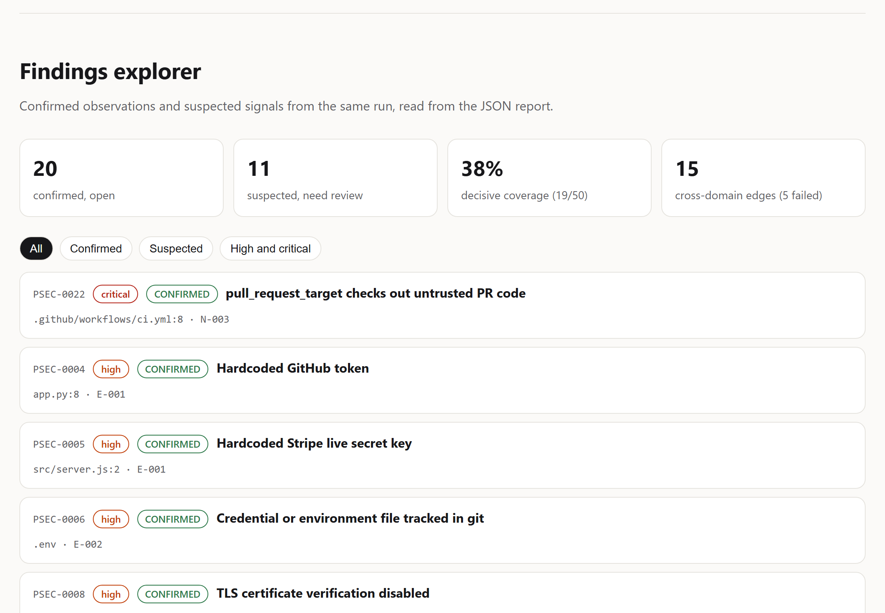
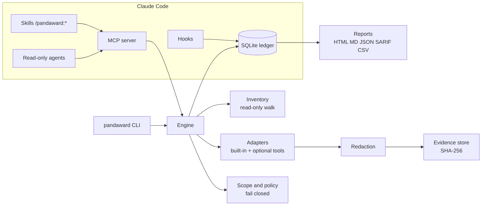

<p align="center">
  
</p>

<h1 align="center">Pandaward</h1>

<p align="center">
  <b>Local, evidence-based application security assessment for your own code.</b><br>
  A standalone Go CLI and a Claude Code plugin. Passive by default. Honest about what it did not test.
</p>

<p align="center">
  <a href="https://github.com/ratomirjovanovic/pandaward/actions/workflows/ci.yml"></a>
  <a href="https://scorecard.dev/viewer/?uri=github.com/ratomirjovanovic/pandaward"></a>
  <a href="LICENSE"></a>
  
  
</p>

<p align="center">
  <a href="https://ratomirjovanovic.github.io/pandaward/">Website and demo</a> ·
  <a href="https://github.com/ratomirjovanovic/pandaward/wiki">Documentation</a> ·
  <a href="#quick-start">Quick start</a> ·
  <a href="#what-pandaward-will-not-tell-you">Limitations</a>
</p>

---

Most scanners print a list of alerts and stop. Pandaward keeps a **ledger**: every control it could check, how it checked it, the redacted evidence, and every control it could *not* decide. Findings are fingerprinted across runs, so a fix becomes `REMEDIATED` only when the check runs again and no longer sees the problem.

<p align="center">
  
  <br><sub>A real session on the bundled demo project, generated by <code>tools/termdemo</code>.</sub>
</p>

<p align="center">
  <a href="https://ratomirjovanovic.github.io/pandaward/demo/">
    <picture>
      <source media="(prefers-color-scheme: dark)" srcset="docs/media/findings-dark.png">
      
    </picture>
  </a>
  <br><sub>Findings from a real scan of the bundled vulnerable fixture. <a href="https://ratomirjovanovic.github.io/pandaward/demo/">Open the live demo</a> for the terminal replay and the full report.</sub>
</p>

## Why Pandaward

| | |
|---|---|
| **Safe by default** | The default profile only reads the repository. It never runs install scripts, Makefiles or builds, never follows symlinks, and sends no traffic to any target. |
| **Human-authorized network tests** | Anything that sends a request needs a scope manifest that a person filled in and approved from an interactive terminal. An AI agent cannot approve it. |
| **No false "all clear"** | Only `PASS` and `FAIL` are decisive. A missing scanner is `BLOCKED`, a crash is `ERROR`, a heuristic hit is `SUSPECTED`. None of them count as secure. |
| **Evidence, not opinions** | Each finding links to a redacted, SHA-256 addressed evidence record. Model-proposed issues stay `HYPOTHESIS` until a human decides. |
| **Secrets never leak** | Values are masked before they are stored, printed, reported or returned to a model. `.env` and key files are recorded by name only. |
| **Remembers across sessions** | State lives in a local SQLite ledger, so context compaction or a restart does not lose results. |
| **Cross-domain thinking** | Links such as *identity -> authorization* (`BC1`) or *webhook -> payment state* (`FG1`) are created from shared assets in your code and tracked separately. |
| **Private** | No account, no telemetry, no cloud backend. |

> **Formerly PenSec.** The project was renamed to Pandaward in 0.2.0. If you used PenSec, see [Moving from PenSec](#moving-from-pensec).

## Quick start

### As a Claude Code plugin

```text
/plugin marketplace add ratomirjovanovic/pandaward
/plugin install pandaward@pandaward            # macOS and Linux
/plugin install pandaward-windows@pandaward    # Windows
```

You can also run the same steps from a terminal with `claude plugin marketplace add ratomirjovanovic/pandaward` and `claude plugin install pandaward-windows@pandaward` (`pandaward@pandaward` on macOS and Linux). Restart Claude Code afterwards; `/mcp` should list `plugin:pandaward:pandaward` as connected. Install only one of the two plugins. If something goes wrong, see [Troubleshooting](https://github.com/ratomirjovanovic/pandaward/wiki/Troubleshooting).

**Updating.** Claude Code does not update third-party marketplaces on its own unless you turn it on. Either turn on auto-update once (`/plugin`, then Marketplaces, `pandaward`, Enable auto-update), or update by hand:

```sh
claude plugin marketplace update pandaward
claude plugin update pandaward-windows@pandaward   # or pandaward@pandaward on macOS and Linux
```

Then restart Claude Code. `/plugin` shows the installed version.

**Uninstalling.** `claude plugin uninstall pandaward-windows@pandaward` (or `pandaward@pandaward`), then `claude plugin marketplace remove pandaward`. Results stay in each project's `.pandaward/` directory until you delete it. The [uninstall guide](https://github.com/ratomirjovanovic/pandaward/wiki/Installation#uninstalling) covers the CLI packages and every file Pandaward creates.

Then, in your project, ask Claude to check its security, or run:

```text
/pandaward:start
```

That is the only command. Claude scans the project, has specialist reviewers look at what automation could not decide, triages the results, builds the fix plan and writes the reports, with a live checklist. At the end it asks one question - fix the plan, record the triage results, install missing scanners - and does what you choose, retesting after every fix. Later in the session it retests on its own whenever code changes. Commands that change a finding's status still show you a confirmation prompt, and network tests always need a scope you approve in your own terminal.

<details>
<summary>Individual skills</summary>

| Skill | What it does |
|---|---|
| `/pandaward:init` | Create `.pandaward/` and show what was detected |
| `/pandaward:scan` | Passive scan with an honest summary |
| `/pandaward:review` | Read-only specialist agents look at what automation could not decide |
| `/pandaward:fix-plan` | Ordered fixes, applied one by one after your approval |
| `/pandaward:retest` | Re-scan after changes and show the delta |
| `/pandaward:report` | HTML, Markdown, JSON, SARIF, CSV |
| `/pandaward:status` | Where the assessment stands and what is stale |

</details>

> The plugin installs prebuilt, checksum-verified binaries from the `plugin` and `plugin-windows` branches, which the release workflow publishes on every version tag ([how to verify them](docs/VERIFYING.md)). To use Pandaward without Claude Code, see below.

### As a CLI

With a package manager:

```sh
brew tap ratomirjovanovic/pandaward https://github.com/ratomirjovanovic/pandaward && brew install ratomirjovanovic/pandaward/pandaward   # macOS, Linux
scoop bucket add pandaward https://github.com/ratomirjovanovic/pandaward; scoop install pandaward/pandaward     # Windows
```

Or download a binary from the [releases page](https://github.com/ratomirjovanovic/pandaward/releases) (Linux and macOS on amd64 and arm64, Windows on amd64). For example on Linux:

```sh
v=v0.2.0
curl -fLO https://github.com/ratomirjovanovic/pandaward/releases/download/$v/pandaward-linux-amd64
curl -fLO https://github.com/ratomirjovanovic/pandaward/releases/download/$v/SHA256SUMS
sha256sum --ignore-missing -c SHA256SUMS
chmod +x pandaward-linux-amd64 && sudo mv pandaward-linux-amd64 /usr/local/bin/pandaward
```

On Windows (PowerShell), save `pandaward-windows-amd64.exe` as `pandaward.exe` in a folder on your `PATH`:

```powershell
Invoke-WebRequest https://github.com/ratomirjovanovic/pandaward/releases/download/v0.2.0/pandaward-windows-amd64.exe -OutFile pandaward.exe
(Get-FileHash pandaward.exe).Hash   # compare with the line in SHA256SUMS
```

Or install with Go 1.23 or later: `go install github.com/ratomirjovanovic/pandaward/cmd/pandaward@latest`. The binary has no runtime dependencies.

Update with `brew upgrade pandaward` or `scoop update pandaward`; for a downloaded binary, replace the file with the new release. Remove with `brew uninstall pandaward` or `scoop uninstall pandaward`, or delete the binary. `pandaward version` shows what you have.

Then, in your project:

```sh
pandaward assess          # init, scan with progress, reports and a summary
pandaward findings        # then dig in
pandaward fix-plan
```

Release binaries are reproducible and come with checksums, a CycloneDX SBOM and signed build provenance; [docs/VERIFYING.md](docs/VERIFYING.md) shows how to check them.

## How it works



1. **Inventory** walks the repository read-only and records files, routes, manifests, workflows, IaC, mobile manifests and AI/MCP usage.
2. **Plan** maps the control catalog (domains A to R) onto what was found. Controls without matching assets become `NOT_APPLICABLE` with a reason you can review.
3. **Adapters** run. Built-in checks are offline and always available; gitleaks, semgrep, osv-scanner, trivy and apktool are used only if you installed them. apktool decodes `.apk` files found in the project (resources only, never the app's code) so the manifest checks also run on what you ship (K-005). When semgrep is installed it runs Pandaward's bundled offline rules (see [`rules/README.md`](rules/README.md)) plus any rules you configure. SARIF 2.1.0 files from analyzers you ran yourself (CodeQL or other SAST tools) are imported from `.pandaward/sarif/*.sarif` and any paths listed in `scan.sarif_files`; Pandaward never runs those tools. Imported results are hypotheses under control R-002, with snippets read and redacted from your files rather than taken from the SARIF.
4. **Findings** are redacted, fingerprinted and linked to evidence. Repeated runs update their lifecycle: `OPEN`, `REMEDIATED`, `REOPENED`, `FALSE_POSITIVE`, `RISK_ACCEPTED`.
5. **Edges** between domains are created only from shared assets and get their status from the linked controls.
6. **Reports** show confirmed findings, suspected signals, coverage by domain, every undecided control and the evidence index.

In Claude Code, hooks keep the ledger current without any command. Edited files are marked stale as they change, and when Claude finishes a turn that edited files, Pandaward runs a changed-only passive retest (bounded at 40 seconds) and hands any new or reopened findings back to Claude, which explains them and offers a fix. A clean retest stays silent; one that runs out of time or fails says so instead of claiming anything is fixed. Set `hooks.auto_retest: false` in `.pandaward/config.yaml` to turn it off.

## What it checks

| Domain | Automated today (offline) | Needs review or runtime |
|---|---|---|
| A Inventory and architecture | entrypoints with file and line (`pandaward routes`): HTTP routes for Express, NestJS, Next.js, Flask, FastAPI, Django, Go, Spring, Laravel, Rails, ASP.NET with router prefixes and mounts resolved; GraphQL schema operations; gRPC services; queue consumers and cron jobs; services in monorepos; OpenAPI drift | threat model |
| B Authentication | JWT `none` or unverified decode, cookie flags | revoked credentials refused (`staging-active`); login, reset and MFA flows |
| C Authorization | | object and function level authorization with test identities (`staging-active`), route review (manual-assisted) |
| D Injection | eval, shell, SQL concatenation, unsafe deserialization | ZAP active scan (`staging-active`, opt-in) |
| E Secrets and crypto | 16 high-specificity secret formats, tracked `.env` and key files, disabled TLS verification, weak hash or random | |
| F Business logic | | invariants, idempotency, races (manual-assisted) |
| G APIs and webhooks | webhook signature verification presence | contract vs runtime |
| H Web | raw HTML sinks, CORS wildcard with credentials | security headers (`production-observe`) |
| I Supply chain | missing lockfiles, npm install scripts, unpinned Python requirements | advisories via osv-scanner |
| J Infrastructure | Dockerfile root and unpinned base, privileged containers, public storage and admin ports in Terraform | trivy |
| K, L Mobile | Android manifest flags and exported components, credentials in SharedPreferences, world-readable storage; iOS ATS, `get-task-allow` in release entitlements, Keychain accessibility and credentials in UserDefaults | built APKs via apktool; plain credentials in app storage on an emulator or simulator (`local-runtime`) |
| N CI/CD | unpinned actions, script injection, `pull_request_target` checkout, token permissions | |
| O Observability | credentials in log calls | alerting review |
| P AI and MCP | model output reaching exec sinks, MCP server pinning and inline credentials | prompt-injection tests |
| R Assurance | evidence integrity, imported SARIF results | |

`pandaward capabilities` prints the full catalog with each adapter's maturity. All adapters are currently `implemented_unvalidated`. The optional tool adapters are exercised in CI on every pull request against gitleaks 8.30.1, semgrep 1.182.0, osv-scanner 2.7.0 and trivy 0.76.1: the job scans the bundled vulnerable fixture and fails when an adapter does not complete or its parser misses the expected findings. Other versions may work but are not checked.

`pandaward benchmark` runs every built-in rule against a versioned corpus of vulnerable and safe cases and prints TP, FP, FN, TN, precision and recall per rule. CI fails when a rule misses a vulnerable case or fires on a safe one, and each release attaches `benchmark.json`. A rule counts as `implemented_and_benchmarked` only with precision and recall of at least 0.95 on at least 3 vulnerable and 3 safe cases. Today every rule has one of each, so none qualifies yet. The corpus is Pandaward's own, so the numbers describe these cases, not real-world accuracy. On the public OWASP Benchmark for Java the built-in rules score 0.00: they match single lines and do not follow data flow, so they find none of its test cases (and raise no false alarms). Use Semgrep or another data flow aware analyzer through Pandaward for Java injection findings; [docs/BENCHMARKS.md](docs/BENCHMARKS.md) has the numbers and how to reproduce them.

## Commands

| Command | What it does |
|---|---|
| `pandaward assess` | The whole local assessment in one step: init if needed, scan with progress bars, reports and a summary |
| `pandaward init` | Create `.pandaward/` with config and a private ledger |
| `pandaward plan` | Applicable controls, gates, candidate edges, inventory gaps |
| `pandaward scan [--fail-on high]` | Passive scan, including SARIF import from `.pandaward/sarif/`; exit code 4 when the gate is reached |
| `pandaward retest [--changed]` | Files changed since the last scan, re-scan, delta; `--changed` re-runs only the adapters whose controls the changes affect |
| `pandaward status` | Coverage, open findings, stale files, blockers, next action |
| `pandaward findings [show ID]` | List or inspect findings; `apply --file` records many decisions at once |
| `pandaward graph [--format mermaid]` | Domains and cross-domain edges |
| `pandaward routes` | Discovered entrypoints (HTTP, GraphQL, gRPC, workers, cron) with file and line |
| `pandaward fix-plan` | Ordered remediation steps |
| `pandaward report [--format ...]` | HTML, Markdown, JSON, SARIF 2.1.0, CSV |
| `pandaward evidence show ID \| verify` | Read or verify redacted evidence |
| `pandaward diff [FROM TO]` | New, reopened, remediated, stale and waived findings between two assessments (default: previous vs latest) |
| `pandaward export --bundle out.zip` | Report and redacted evidence with a SHA-256 manifest for a reviewer; never raw tool output |
| `pandaward verify-bundle out.zip` | Recompute every hash in a bundle; compare the printed manifest hash with the sender's |
| `pandaward scope init \| validate \| approve \| revoke` | Authorization for network tests |
| `pandaward test --profile production-observe` | Header and cookie review of approved origins |
| `pandaward test --profile local-runtime` | Storage of the configured Android test build on a running emulator and the iOS test build in a booted simulator; real devices are refused |
| `pandaward test --profile staging-active` | Authorization checks with test identities, then a ZAP spider and passive scan of approved staging origins, active scan when the manifest allows it |
| `pandaward feedback false-positive ID \| false-negative \| summary` | Prepare a report about a wrong or missed finding; prints a prefilled issue link, sends nothing |
| `pandaward doctor` | Optional scanners and their network needs |
| `pandaward benchmark` | TP, FP, FN and TN per built-in rule on the bundled corpus |
| `pandaward selftest` | Runs a hostile fixture repository (instructions in comments, README, OpenAPI, MCP descriptions and scanner output) through scan, reports, MCP and hooks and checks Pandaward was not steered by it; CI and every release run it and fail on any case |
| `pandaward mcp` | Local stdio MCP server used by the plugin |

Human decisions are explicit and recorded:

```sh
pandaward findings false-positive PW-0007 --by "Jane" --note "constant input, not user controlled"
pandaward findings accept-risk   PW-0003 --by "Jane" --note "internal tool" --expires 2027-03-01
pandaward findings apply --file decisions.json --by "Jane"   # many at once, all or nothing
```

`decisions.json` is an array of `{"finding_id", "action", "note", "expires"}` with `action` one of `confirm`, `false-positive`, `accept-risk` (needs `expires`) or `reopen`. Every entry is checked before anything is written, so one bad entry rejects the batch. In Claude Code this is how the guided assessment records triage results: you see the whole list in one confirmation prompt instead of one prompt per finding.

## Network tests

Network tests are off until you turn them on yourself:

```sh
pandaward scope init                       # writes .pandaward/scope.yaml, unusable as shipped
# fill in owner, written permission reference, purpose, targets, limits, acknowledged: true
pandaward scope approve --by "Jane"        # interactive terminal only, bound to the file's SHA-256
pandaward test --profile production-observe
pandaward test --profile staging-active    # staging or local targets, needs ZAP
```

The engine sends at most `max_requests_total` GET requests to the listed origins at the configured rate, never follows redirects, and checks every resolved address at connection time. Loopback, private and link-local addresses are refused unless the manifest explicitly allows a local fixture, and cloud metadata addresses are always refused. Editing `scope.yaml` invalidates the approval. Approvals are also bound to a per-user key kept outside the project (`approval.key` in your user config directory), so a scope file or ledger that arrives with a repository never counts as approved.

`staging-active` runs your installed [ZAP](https://www.zaproxy.org/) (it needs Java 17+; Pandaward never installs it) through its automation framework: a spider and the passive scan decide M-001, and with `zap.active_scan: true` in the manifest the active scan also decides D-005 (injection). ZAP is chained to a Pandaward proxy on loopback that terminates TLS and sends each request through the same scope guard, so origins, excluded paths, allowed methods, the request budget, the rate limit and the address checks apply to every ZAP request. The guard also stops after three consecutive 429 or 5xx answers. A ZAP run that fails is `ERROR`, a run cut short by the budget or the guard is `INCONCLUSIVE`, and targets marked `environment: production` are refused. Set `runtime.zap_path` in `.pandaward/config.yaml` when ZAP is not on `PATH` or in its default install location.

`staging-active` also runs the manifest's `authorization_checks` before ZAP. You list test identities (name, tenant, the header that carries the credential and the environment variable that holds it; the credential itself never goes in the file) and read-only requests to objects or functions that exist for the test, each with the identities allowed to reach it:

```yaml
identities:
  - {name: alice, tenant: acme, header: Authorization, value_env: PANDAWARD_ID_ALICE}
  - {name: bob,   tenant: beta, header: Authorization, value_env: PANDAWARD_ID_BOB}
  - {name: carol, tenant: acme, header: Authorization, value_env: PANDAWARD_ID_CAROL}   # an admin
  - {name: alice-logged-out, tenant: acme, header: Authorization, value_env: PANDAWARD_ID_OLD, revoked: true}
authorization_checks:
  - {name: acme invoice, kind: object,   method: GET, path: /api/invoices/inv_acme_1, allowed: [alice]}
  - {name: user admin,   kind: function, method: GET, path: /admin/users,            allowed: [carol]}
```

Each check is sent once as every identity and once without credentials. The allowed identities must get a 2xx answer, otherwise the check cannot be judged and is `INCONCLUSIVE`. Any other identity that also gets a 2xx is a finding: `CONFIRMED` when its body matches what the allowed identities got, `STRONGLY_SUPPORTED` when it differs. Object checks decide C-001 (BOLA), function checks C-002, and identities marked `revoked` decide B-004 on every check. Only GET and HEAD are allowed, so no data changes and nothing needs cleaning up. Evidence keeps the status, size, content type and a body hash per identity, never headers, bodies or credentials. A missing credential variable stops the run before the first request.

## Emulator and simulator checks

`pandaward test --profile local-runtime` looks at what a test build actually stored. It sends no network traffic, so it needs no scope manifest:

```yaml
# .pandaward/config.yaml
runtime:
  android_package: com.acme.shop      # debuggable test build on a running emulator
  ios_bundle_id: com.acme.shop        # test build in a booted simulator (macOS)
```

On Android it uses `adb` with an `emulator-*` serial that also reports `ro.kernel.qemu=1`, and reads the app's `shared_prefs` through `run-as`, which only works for debuggable builds. On iOS it uses `xcrun simctl get_app_container booted` and only accepts a container inside CoreSimulator, then reads the app's preferences plist. A non-empty value under a credential-like key (token, password, session and similar) is a finding for K-003 or L-002; Pandaward records the key name and never the value. Real devices are refused, and a missing emulator, simulator, tool or setting makes the control `BLOCKED` with the reason. Transport security and Keychain accessibility are not tested at runtime.

## In CI

```yaml
permissions:
  contents: read
  security-events: write
steps:
  - uses: actions/checkout@<pinned-sha>
  - id: pandaward
    uses: ratomirjovanovic/pandaward@<pinned-sha>   # v0.1.3 or later
    with:
      fail-on: high          # empty to never fail on findings
      new-only: "true"       # on pull requests, gate only on findings the change introduces
  - if: always()
    uses: github/codeql-action/upload-sarif@<pinned-sha>
    with:
      sarif_file: ${{ steps.pandaward.outputs.sarif-file }}
```

The action downloads a release binary, checks it against `SHA256SUMS`, scans, writes SARIF, HTML, Markdown and JSON reports to `pandaward-report/`, and adds a short job summary with counts only (`summary: full` lists findings; job summaries of public repositories are public). With `new-only`, the base commit is scanned in a separate worktree and only findings whose fingerprints are new count. Inputs and outputs are documented in [`action.yml`](action.yml).

## Before each commit

With [pre-commit](https://pre-commit.com), add this to `.pre-commit-config.yaml` and run `pandaward init` once in the project:

```yaml
repos:
  - repo: https://github.com/ratomirjovanovic/pandaward
    rev: v0.2.0
    hooks:
      - id: pandaward-system   # uses the pandaward on your PATH; use id: pandaward to build it with Go 1.23+
```

The hook runs `pandaward scan --quiet --fail-on high` and blocks the commit when open high or critical findings exist. It scans the working tree, not only the staged files.

## What Pandaward will not tell you

- That your application is secure. No tool can prove the absence of vulnerabilities.
- Anything about controls it reports as `BLOCKED`, `UNSUPPORTED`, `SUSPECTED`, `INCONCLUSIVE`, `ERROR` or `STALE`.
- Results from runtime tests that are not implemented yet: login, reset and MFA flows (B-003), API contract versus runtime (G-002) and prompt-injection tests against an LLM endpoint (P-003) are reported as `UNSUPPORTED` today.

A Pandaward report is an automated technical assessment. It is not a certification, an attestation, a legal opinion or an independently signed penetration test.

## Roadmap

| Milestone | Scope | State |
|---|---|---|
| M0 Foundation | CLI, ledger, scope policy, inventory, static report | done |
| M1 Public alpha | built-in adapters, optional tool adapters, bundled Semgrep rules, edges, HTML/JSON/SARIF, plugin, signed reproducible releases | done (v0.1.1) |
| M2 Context-safe beta | per-domain invalidation, targeted retest, evidence bundles, delta reports, hostile-repository suite | done |
| M3 Runtime beta | staging profile with role and tenant fixtures, ZAP adapter | done |
| M4 Mobile and AI | apktool and emulator or simulator storage checks, release-blocking hostile-repository suite; MobSF and LLM endpoint tests | in progress |
| 1.0 | frozen schemas ([done](docs/SCHEMAS.md)), benchmark corpus with at least 3 vulnerable and 3 safe cases per rule, external review | in progress |

See the [issues](https://github.com/ratomirjovanovic/pandaward/issues) for details.

## Moving from PenSec

Pandaward 0.2.0 is PenSec renamed. Your results carry over:

- The first `pandaward` command in a project moves `.pensec/` to `.pandaward/` with its ledger, evidence, reports, config and scope manifest. Commit the renamed files if you had committed `.pensec/config.yaml` or `scope.yaml`.
- Approvals stay valid: the approval key is taken over from the old `pensec` folder in your user config directory.
- `PENSEC_*` environment variables are still read when the `PANDAWARD_*` ones are not set.
- Existing finding IDs such as `PSEC-0007` keep working; new findings get `PW-` IDs.

Switch the tools once:

```text
/plugin uninstall pensec-windows@pensec        # or pensec@pensec
/plugin marketplace remove pensec
/plugin marketplace add ratomirjovanovic/pandaward
/plugin install pandaward-windows@pandaward     # or pandaward@pandaward on macOS and Linux
```

CLI: `brew uninstall pensec && brew untap ratomirjovanovic/pensec`, then install `pandaward` as above (`scoop uninstall pensec; scoop bucket rm pensec` on Windows). In CI, point `uses:` at `ratomirjovanovic/pandaward`; GitHub redirects the old name for now, but pin the new one.

## Wrong or missed findings

Tell us, and the rule gets fixed. `pandaward feedback false-positive <PW-ID>` or `pandaward feedback false-negative --rule <id>` (or `/pandaward:feedback` in Claude Code) prepares a report with rule metadata only and prints a prefilled issue link; nothing is sent unless you submit it. Reports are grouped by rule, prioritized automatically and every fix adds a benchmark case. See [docs/FEEDBACK.md](docs/FEEDBACK.md).

## Contributing and security

Contributions are welcome. Start with [CONTRIBUTING.md](CONTRIBUTING.md). Please report vulnerabilities in Pandaward itself privately as described in [SECURITY.md](SECURITY.md).

## License

Pandaward is free and open source software under the [GNU Affero General Public License v3.0](LICENSE) (AGPL-3.0-only).

You may use, study, modify and share it, including inside companies. If you distribute Pandaward or a modified version, or let others use a modified version over a network (for example as a hosted scanning service), you must publish the complete corresponding source code under the same license. Commercial licensing for uses that cannot meet these terms is available from the copyright holder.

Third-party scanners that Pandaward can call keep their own licenses. The license does not apply to the projects you assess or to the reports Pandaward produces about them.
